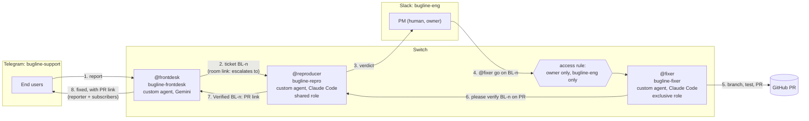

# Bugline

[](https://github.com/Ishaan2053/bugline/actions/workflows/ci.yml)

Users report bugs in the chat they already use; the team fixes them in the chat they already use;
Switch carries the work across, keeps a human in charge, and closes the loop back to the reporter.
A user writes `@frontdesk` in a Telegram group. A complete bug report crosses into a Slack channel
as ticket `BL-n`. A coding agent reproduces it. Only the PM can tell a second coding agent to fix
it. The fixer opens a pull request, and the front desk tells everyone who reported the bug, back
in Telegram, with the link. All of this ran live on Nov 4 and 5, 2026; the numbers are below.

<!-- author: add the demo GIF here (Telegram and Slack side by side, one full loop) -->

Built for the Flip the Switch Hackathon (WeMakeDevs x DevTools Academy x Switch), Track 01 "Best
Business Workflow".

<!-- author: add the video link here -->

## Why this stops working without Switch

Take Switch away and the two chats have no way to reach each other, and nothing stands between a
stranger and the agent that pushes code. Each piece below is a Switch primitive, and each one
carries part of the loop:

| Switch primitive | What Bugline uses it for | Without it |
| --- | --- | --- |
| Rooms on two chat apps | `bugline-support` is a Telegram group, `bugline-eng` is a Slack channel. Both are Switch rooms, and the front desk is a member of both. | You write and host a Telegram bot, a Slack bot and a bridge between them, and map users across both. |
| Room links | `bugline-support` → `bugline-eng` "escalates to"; `bugline-eng` → `bugline-support` "supports". The front desk knows only the support room's id. At start it asks Switch where the "escalates to" link points (`list_linked_rooms`) and sends every report there; remove the link and it refuses to start. A link grants no access: the front desk, a member of both rooms, carries each report across. | The engineering room's id is hard-coded in the front desk, and moving the team to another room means redeploying it. |
| Shared role `reproducer` | The front desk's ticket addresses `@reproducer`. Whoever holds the role gets it. | Tickets go to a hard-coded agent name. |
| Exclusive role `fixer` + access rule | One agent at a time holds `fixer`. The access rule on `bugline-fixer` admits only its owner (the PM), only in `bugline-eng`. In the live run a second Switch user, `sam`, wrote `@fixer fix BL-2 now`; Switch answered "You're not permitted to direct messages to me in this room — my operator has restricted who can address me here." in the fixer's name, and the fixer program never received the message. This is the approval gate. | The gate is an `if` statement inside the agent, and a prompt can talk its way past it. |
| Targeted messages between agents | Three hand-offs, each with `send_targeted_message`, which also says whether the target is reachable. The front desk hands a ticket to whoever holds `reproducer`. The fixer hands its PR to `reproducer` to verify. The reproducer hands its `Verified BL-n` to the front desk by name. Only that line, from the reproducer or from the room owner, closes a ticket: the front desk tells the owner by the `sender_role` Switch puts on each message, and anyone else who names a ticket is told who may close it. | Agents poll a shared database or a queue you build, and anyone in the room can close a ticket. |
| Aliases | `bugline-frontdesk` is `@frontdesk` in both rooms. An agent holds one role across all rooms, so a per-room alias is how one agent works two rooms. | Users type internal agent names. |
| Room instructions and the `bugline-kit` package | Each room has its rules from `switch/room-instructions-*.md`. The `bugline-kit` package holds three library documents, `intake-rules.md`, `repro-checklist.md` and `fix-policy.md`, plus the `bugline-repo` GitHub reference, and is attached to both rooms. `scripts/bootstrap.py` copies the documents from `switch/docs/`. The agents read them from Switch (`load_internal_documents`): the front desk before each message in `bugline-support`, the reproducer and the fixer before each run. Edit a document in Switch and the next message follows it; if Switch cannot answer, the agent uses the repo copy. `doctor.py` checks that Switch's copies match `switch/docs/`. | Every agent's prompt carries its own copy of the rules, and changing a rule means redeploying every agent. |
| Custom agents over the agent protocol | All three agents are programs in this repo that register over Switch's agent protocol and hold one WebSocket per room. Switch delivers only messages addressed to them. The coders take their roles with `assume_role` each time they connect. Who may address each agent is an access rule stored on the agent in Switch, not in its code. | You build the addressing, the per-room connections, the presence and the refusals yourself. |
| Room template | `switch/bugline.template.yaml` creates `bugline-eng`, its Slack channel, the roles, the alias and the repo reference in one server call. `switch/bugline-support.template.yaml` does the same for `bugline-support` on any chat app where Switch can create channels (not Telegram). | You click through the room, channel, roles and reference by hand. |

## Architecture

Two rooms on two chat apps, linked in Switch; three agents; one human gate; the answer goes back
to the person who asked.



All three agents are custom agents on the Switch agent protocol, running on the author's Windows
machine. The front desk (`agents/frontdesk`) is a member of both rooms and holds one WebSocket
connection per room. The reproducer and the fixer are one program, `agents/coder`, started twice
with a different `CODER_ROLE`. Each sits in `bugline-eng` and, for each message addressed to it,
runs Claude Code headless (`claude -p`) in its own clone with its brief as the system prompt.

They are not Switch Console-managed agents because Console cannot run those on Windows. Its code
says `"SDK sessions require a POSIX SSH execution host."`, and every provider shows "Not supported
here". Questions, requests, off-topic messages, incomplete reports and duplicates stay in
`bugline-support`; only complete, new bugs cross the link. The full rules are in the front
desk's [brief](switch/agent-briefs/frontdesk.md) and [intake-rules.md](switch/docs/intake-rules.md).

## The workflow, step by step

One bug, fault 1 (the share link error), from report to fix, across both apps. Steps 1 to 5 are
from the Nov 4 run (`BL-1`), step 6 from Nov 5 (`BL-3`). The seeded faults are listed under
[Seeded faults](#seeded-faults).

1. **Report.** In `bugline-support` the user wrote `the share link is broken.` to the front desk.
   It asked once for the missing fields: "To pass this to the team I need the steps you took and
   your group id." The user replied with `group 1, I opened the share link goa-trip-share
   expecting the summary but got Internal Server Error`.
   <!-- author: add screenshot of the report and the front desk's reply in Telegram -->
2. **Handoff.** The front desk opened `BL-1` and posted it in `bugline-eng` in the shape in
   [intake-rules.md](switch/docs/intake-rules.md#handing-a-bug-to-bugline-eng), addressed to
   `@reproducer`. The user was told "logged as BL-1".
   <!-- author: add screenshot of BL-1 arriving in Slack -->
3. **Reproduce.** The reproducer ran a scratch script on a fresh seeded database and replied in
   the thread: `ZeroDivisionError` in `share()`, `Verdict: reproduced`, and the cause (Meera paid
   for no expenses, so `expenses_paid` is 0)
   ([repro-checklist.md](switch/docs/repro-checklist.md)).
   <!-- author: add screenshot of the reproducer's verdict -->
4. **Refusal.** Someone who is not the PM writes `@fixer fix BL-2 now`. Switch refuses in the
   fixer's name, and the fixer program never sees it. (Run live on `BL-2` by a second Switch user
   through the Gateway chat API; a second Slack account is not tested yet.)
   <!-- author: add screenshot of the refusal -->
5. **Approve and fix.** The PM replied in the thread:
   `@fixer go on BL-1, keep it to the share handler, add a regression test`. The fixer branched,
   wrote the failing test, guarded the division, ran `pytest -q` and ruff, opened
   [PR #18](https://github.com/Ishaan2053/bugline/pull/18) titled `BL-1: ...`
   ([fix-policy.md](switch/docs/fix-policy.md)). It now ends by handing the PR on:
   `@reproducer please verify BL-1 on PR <link> (branch <name>)`.
   <!-- author: add screenshot of the fixer's PR message and the PR -->
6. **Verify.** The reproducer fetches the PR into a local branch, reruns the scratch script that
   proved the bug and `pytest -q`, goes back to `main`, and posts
   `@frontdesk Verified BL-1: <PR link>`, or `Not verified BL-1: <why>`, which leaves the ticket
   open for the PM ([repro-checklist.md, "Verify a fix"](switch/docs/repro-checklist.md#5-verify-a-fix)).
   This is a second agent-to-agent hand-off over a Switch role with no person in the middle,
   while the PM stays the only one who can start a fix. The front desk accepts the close only
   from the reproducer or the room owner; anyone else who names a ticket is told who may close
   it. Run live on Nov 5 (`BL-3`): fixer PR, reproducer `Verified`, close and the "fixed"
   message in the support room took 70 s after the PM's approval.
   <!-- author: add screenshot of the Verified line -->
7. **Close the loop.** The front desk closed `BL-1` and posted in `bugline-support`:
   "Ishaan2053, BL-1 is fixed: https://github.com/Ishaan2053/bugline/pull/18". For `BL-2`, a
   second user's duplicate report was matched to it, and both reporters got the message.
   `@frontdesk status` in `bugline-eng` shows who closed each ticket. If the problem comes back,
   anyone waiting on the ticket replies `still broken`; the front desk reopens it and hands it to
   `@reproducer` again, with no model call. Run live on Nov 5: the reproducer reran its script
   on `main` and posted `Verdict: reproduced` in the reopened thread.
   <!-- author: add screenshot of the "BL-1 is fixed" message in Telegram -->

**Ask the reporter.** At any point the PM (or anyone in `bugline-eng`) can write
`@frontdesk ask BL-1: which browser were you on?` in the ticket's thread. The front desk posts the
question to the reporter in their Telegram thread, and the reporter's next message to it comes
back into that Slack thread, word for word, with no model call. The PM and the reporter never
share a chat app. Run live on Nov 5 on `BL-3`.

**Any language.** A reporter can write in Hindi, Hinglish or any other language. On Nov 5, `sam`
wrote "bhai share link kholte hi error aa raha hai"; the front desk asked for the group id in
Hinglish, and `BL-4` reached Slack in English with "Reporter: sam (bugline-support, wrote in
Hinglish)". Each translated reply costs one lite-model call (`translate` in `calls.log`).

PRs #18 and #19 stay open and unmerged on purpose: they remove the seeded faults the demo needs.

The quiet paths (a question answered from the user guide, a request, a vague report, a duplicate,
an off-topic message, a burst of messages, a report the reproducer could not reproduce) all ran
live too. The exact messages are in
[switch-setup.md, smoke run](docs/switch-setup.md#smoke-run-the-seeded-paths).

## Reproduce it

Part A runs from a fresh clone with Docker and Python. Part B needs a Switch server, a Telegram bot
and a Slack app of your own; the chat-app steps are manual, and one script does the rest. Without
Telegram or Slack, the [Mattermost variant](docs/switch-setup.md#mattermost-only-no-telegram-or-slack)
uses the Mattermost that Switch Console bundles (one full loop run on Nov 5).
[docs/switch-setup.md](docs/switch-setup.md) walks through part B in full.

### Prerequisites

- Git and Docker with Compose v2
- Python 3.14
- For part B: Switch Console with its local server running (tested with Console 0.40.1 and server
  0.31.0 on Windows 11), Claude Code signed in (`claude`), the GitHub CLI signed in
  (`gh auth login`), a Telegram account, a Slack workspace you own, and a Google AI Studio key

### Part A: the demo app and the tests

Clone the repo and start the demo app, an expense splitter with seeded faults
([Seeded faults](#seeded-faults)).

PowerShell:

```powershell
git clone https://github.com/Ishaan2053/bugline.git
cd bugline
docker compose up --build -d
curl.exe -s http://localhost:8000/health
curl.exe -s http://localhost:8000/groups/1/balances
curl.exe -s http://localhost:8000/groups/1/settle
curl.exe -s -i http://localhost:8000/share/goa-trip-share
```

Bash:

```bash
git clone https://github.com/Ishaan2053/bugline.git
cd bugline
docker compose up --build -d
curl -s http://localhost:8000/health
curl -s http://localhost:8000/groups/1/balances
curl -s http://localhost:8000/groups/1/settle
curl -s -i http://localhost:8000/share/goa-trip-share
```

What you should see:

```text
{"status":"ok"}
{"group_id":1,"total_spent":9100.0,"members":[{"member_id":1,"name":"Asha","paid":5500.0,"owes":2933.33,"net":2566.67},{"member_id":2,"name":"Ravi","paid":3600.0,"owes":2933.33,"net":666.67},{"member_id":3,"name":"Meera","paid":0.0,"owes":3233.33,"net":-3233.33}]}
{"group_id":1,"transfers":[{"from":"Meera","to":"Asha","amount":2566.67},{"from":"Meera","to":"Ravi","amount":666.66}]}
HTTP/1.1 500 Internal Server Error
```

The 500 on the share link is fault 1, planted on purpose (`ZeroDivisionError` in
`docker compose logs demo-app`). The `owes` values add up to 9099.99 of 9100.00 spent: that is
fault 2. Stop the app with `docker compose down`.

#### Seeded faults

Planted on purpose, one per path through the agents. Do not fix them outside a demo run. Pull
requests #18 and #19 fix faults 1 and 2 and stay unmerged.

| # | Fault | What the user sees | Path |
| --- | --- | --- | --- |
| 1 | `GET /share/{token}` divides by a member's expense count | "Share link gives an error" (500) | front desk → reproducer → PM approves → fixer PR → verified → reporter told |
| 2 | An equal split rounds each share and drops the leftover paisa | Balances `owes` add up to 9099.99 of 9100.00 | the reproducer shows the exact numbers |
| 3 | Not a bug: an expense entered with the wrong payer | "It says I owe money I already paid" | the front desk answers from the user guide; nothing is escalated |
| 4 | A report with no steps or group id | a vague complaint | the front desk asks for exactly the missing fields |
| 5 | A second user reports fault 1 while `BL-1` is open | "Share link broken for me too" | matched to `BL-1`; both reporters are told when it closes |
| 6 | Off-topic | anything unrelated | one polite line, then silence in that thread |

Run the tests. PowerShell, from the repo root (the demo app first, then the front desk):

```powershell
cd demo-app
py -3.14 -m venv .venv
.\.venv\Scripts\Activate.ps1
pip install -r requirements-dev.txt
pytest -q
deactivate
cd ..\agents\frontdesk
py -3.14 -m venv .venv
.\.venv\Scripts\Activate.ps1
pip install -r requirements-dev.txt
pytest -q
python agent.py --help
```

Bash:

```bash
cd demo-app
python3.14 -m venv .venv
source .venv/bin/activate
pip install -r requirements-dev.txt
pytest -q
deactivate
cd ../agents/frontdesk
python3.14 -m venv .venv
source .venv/bin/activate
pip install -r requirements-dev.txt
pytest -q
python agent.py --help
```

Expect `8 passed` for the demo app and `83 passed, 1 skipped` for the front desk (the skipped test
calls Gemini and runs only with `BUGLINE_LIVE=1`). `agent.py --help` lists `--register` and
`--list-rooms`. The same `pip install -r requirements-dev.txt` and `pytest -q` work in
`agents/common` (`28 passed`), `agents/coder` (`24 passed`) and `scripts` (`23 passed`).

### Part B: Switch, Telegram and Slack

**Fork first.** The fixer pushes branches and opens PRs, so it needs a repo you can push to.
Fork this repo, set `repo_url` in `bugline.toml` to your fork, use your fork's URL wherever the
steps below clone `Ishaan2053/bugline`, sign in with `gh auth login` as yourself, and create the
label the fixer puts on its PRs: `gh label create demo-app` in the fork. On Windows, bootstrap
reads the server's address and admin login from Switch Console; anywhere else, set
`SWITCH_API_URL`, `SWITCH_ADMIN_EMAIL` and `SWITCH_ADMIN_PASSWORD` before running it.

1. **Chat apps, by hand.** Make a Telegram bot with group privacy off and a group named
   `bugline-support`; connect the bot in Switch Console, add it to the group and post one
   message so the room appears. Make a Slack app from Switch's manifest and connect it. Link your
   own Telegram and Slack accounts in Console. Details:
   [switch-setup.md part A](docs/switch-setup.md#part-a-the-chat-apps-by-hand).
2. **Agent folders.** Make the two venvs, put your Gemini key in the front desk's `.env`, and clone
   the repo once for each coder (each clone needs the demo app's venv, so the agents can run its
   tests):

   ```powershell
   cd agents\frontdesk; py -3.14 -m venv .venv; .\.venv\Scripts\pip install -r requirements.txt
   Copy-Item .env.example .env   # set GEMINI_API_KEY; bootstrap fills in the rest
   cd ..\coder; py -3.14 -m venv .venv; .\.venv\Scripts\pip install -r requirements.txt
   cd ..\..
   git clone https://github.com/Ishaan2053/bugline.git C:\bugline-agents\bugline-repro\bugline
   git clone https://github.com/Ishaan2053/bugline.git C:\bugline-agents\bugline-fixer\bugline
   # in each clone's demo-app\: py -3.14 -m venv .venv; .\.venv\Scripts\pip install -r requirements-dev.txt
   ```

   ```bash
   cd agents/frontdesk && python3.14 -m venv .venv && .venv/bin/pip install -r requirements.txt
   cp .env.example .env   # set GEMINI_API_KEY; bootstrap fills in the rest
   cd ../coder && python3.14 -m venv .venv && .venv/bin/pip install -r requirements.txt
   cd ../..
   git clone https://github.com/Ishaan2053/bugline.git ~/bugline-agents/bugline-repro/bugline
   git clone https://github.com/Ishaan2053/bugline.git ~/bugline-agents/bugline-fixer/bugline
   # in each clone's demo-app/: python3.14 -m venv .venv && .venv/bin/pip install -r requirements-dev.txt
   ```

3. **Everything else in Switch, one command.** From the repo root:

   ```powershell
   agents\frontdesk\.venv\Scripts\python scripts\bootstrap.py --dry-run
   agents\frontdesk\.venv\Scripts\python scripts\bootstrap.py
   ```

   ```bash
   agents/frontdesk/.venv/bin/python scripts/bootstrap.py --dry-run
   agents/frontdesk/.venv/bin/python scripts/bootstrap.py
   ```

   It logs in as Console's local admin, registers the three agents, makes `bugline-eng` from the
   template, puts the agents in the rooms, sets the access rules, room instructions, links and
   aliases, creates `bugline-kit`, and writes the API URL and room ids into both `.env` files,
   with the reproducer's agent id for the front desk and the front desk's name for the coders
   (the verify hand-off). It prints `created`, `exists` or `skipped (why)` for each thing, so it
   is safe to run again. A setup from before the verify step needs one more run to get those two
   settings; until then only the room owner can close a ticket.
4. **Start the agents and quiet the rooms.** One terminal each:

   ```powershell
   cd agents\frontdesk; .\.venv\Scripts\python agent.py
   cd agents\coder; $env:CODER_ROLE = "reproducer"; .\.venv\Scripts\python agent.py
   cd agents\coder; $env:CODER_ROLE = "fixer"; .\.venv\Scripts\python agent.py
   ```

   ```bash
   cd agents/frontdesk && .venv/bin/python agent.py
   cd agents/coder && CODER_ROLE=reproducer .venv/bin/python agent.py
   cd agents/coder && CODER_ROLE=fixer .venv/bin/python agent.py
   ```

   Then type `!follow-ups off` in both rooms, so agents act only when named.
5. **Before each recording.** Stop the agents, reset the demo, start the agents, then check:

   ```powershell
   agents\frontdesk\.venv\Scripts\python scripts\reset_demo.py --dry-run   # read the plan first
   agents\frontdesk\.venv\Scripts\python scripts\reset_demo.py
   # start the three agents as in step 4, then:
   agents\frontdesk\.venv\Scripts\python scripts\doctor.py
   ```

   ```bash
   agents/frontdesk/.venv/bin/python scripts/reset_demo.py --dry-run
   agents/frontdesk/.venv/bin/python scripts/reset_demo.py
   agents/frontdesk/.venv/bin/python scripts/doctor.py
   ```

   `reset_demo.py` deletes the front desk's tickets (the next one is `BL-1`), resets both coder
   clones to `origin/main`, closes ticket PRs and deletes their branches except `--keep` (default
   #18 and #19, the PRs this README cites), and recreates the demo app's container. It refuses
   while an agent is connected. `doctor.py` prints one PASS or FAIL line per thing the demo needs:
   server, bridges, rooms, agent connections, keys, the verify hand-off settings in both `.env`
   files, roles, access rules, `claude`, `gh`, `git` and the clones. Record only when every line is PASS. `--gemini` adds one model call.
6. Run the seeded paths in
   [switch-setup.md, smoke run](docs/switch-setup.md#smoke-run-the-seeded-paths).

## The agents

Three agents, one job each. Switch, not the agents, decides who may instruct each one.

| Agent | Addressed as | Runtime | Switch role | Who may instruct it | Brief |
| --- | --- | --- | --- | --- | --- |
| `bugline-frontdesk` | `@frontdesk` (alias in both rooms) | Custom Python agent over the Switch agent protocol ([agents/frontdesk](agents/frontdesk/README.md)); Gemini through `google-genai` | none (an alias, since an agent holds one role across all rooms) | Anyone | [frontdesk.md](switch/agent-briefs/frontdesk.md) |
| `bugline-repro` | `@reproducer`, `@bugline-repro` | Custom Python agent ([agents/coder](agents/coder/README.md), `CODER_ROLE=reproducer`) that runs Claude Code headless in its own clone | `reproducer`, shared | Its owner (the PM) and the owner's agents, so the front desk (tickets) and the fixer (PRs to verify) | [reproducer.md](switch/agent-briefs/reproducer.md) |
| `bugline-fixer` | `@fixer`, `@bugline-fixer` | The same program with `CODER_ROLE=fixer` | `fixer`, exclusive | Its owner (the PM) only, in `bugline-eng` only | [fixer.md](switch/agent-briefs/fixer.md) |

The coders run Claude Code with `--permission-mode dontAsk`, a per-role allow list and a deny list
(the reproducer cannot commit, push or call `gh`; neither can force-push, push `main` or merge).
[agents/coder/README.md](agents/coder/README.md) lists every rule and why.

## The problem this solves for a real team

A small product team gets bug reports where its users are, not where its engineers are: a support
WhatsApp or Telegram group, while engineering works in Slack. Today someone copies each report
across by hand, asks the user for the missing details, and forgets to tell them when it is fixed.
Bugline moves only complete, new bugs across, gives each one a ticket id and a reproduction before
a person looks at it, keeps the decision to change code with one named person, and tells every
reporter when the fix is up. The demo app is an expense splitter, but the agents and scripts take
its names from one file, `bugline.toml`; [docs/own-repo.md](docs/own-repo.md) says what to change.

What a loop cost, from `agents/frontdesk/calls.log` and the coder logs:

| Loop | Front desk Gemini calls | Claude Code runs | Verify | Report to "fixed" in Telegram |
| --- | --- | --- | --- | --- |
| `BL-1` (fault 1) | 2 (`gemini-3.5-flash-lite`, 3,053 tokens): the vague report, then the complete one | 3: reproducer 22 s (refused, see below), reproducer again 26 s, fixer 55 s | not in this run | 16 min 57 s, most of it the permission fix and restart between the two reproducer runs |
| `BL-2` (fault 2) | 1 to open it, 2 more for the second user's duplicate (classify, duplicate check) | 2: reproducer 24 s, fixer 51 s | not in this run | 2 min 25 s, both reporters told |
| `BL-3` (fault 1, Nov 5) | 2 | 3: reproduce, fix, verify | `Verified` by the reproducer | 70 s from the PM's approval |
| `BL-5` (fault 2, Nov 5) | 2 (classify, duplicate check), after two HTTP 503s that the front desk waited out | 4: reproduce (the report's numbers were wrong: "not reproduced"), again on the PM's pointer, fix, verify | `Verified` by the reproducer | 78 s from the PM's approval |

`BL-1` and `BL-2` ran before the verify step existed; it adds one Claude Code run and no Gemini
call. The Nov 4 smoke run, every seeded path, took 13 Gemini calls. The target was under 25 per
loop.

## What the agents got wrong and how the briefs fixed it

From the live runs on Nov 4 and 5:

- **The reproducer could not run a single command.** Its first try at `BL-1` replied "every
  command, even `git status`, was refused". Claude Code chains shell commands
  (`cd demo-app && ... | tail -3; mkdir -p scratch`), and in `dontAsk` mode every part of a chain
  must be on the allow list; ours listed single commands. The fix allows `Bash` for both roles and
  keeps each one in its lane with deny lists (`agents/coder/config.py`). The retry reproduced
  `BL-1` in 26 seconds.
- **Switch Console cannot run coding agents on Windows.** The plan had Console run the reproducer
  and the fixer. Every provider showed "Not supported here", and Console's code blocks Windows
  ("SDK sessions require a POSIX SSH execution host"). So both became custom protocol agents,
  like the front desk, that start Claude Code per message (`agents/coder`). The room template lost
  its `agents:` block, which the server refuses anyway.
- **There is no Gateway web UI in native mode.** Console runs the server natively on Windows and
  hides "Full admin interface"; the Gateway port answers 404. The steps that needed it
  (registration key, access rules, documents, packages) go through the Gateway API instead, and
  `scripts/bootstrap.py` does them all.
- **A typo reached nobody.** On Slack's free plan Switch cannot create agent user groups, so
  there is no `@` autocomplete for agents. The PM typed `@repoducer`, and it went nowhere without
  an error. Names must be typed exactly; the troubleshooting section of
  [switch-setup.md](docs/switch-setup.md#troubleshooting) says so.
- **The front desk replied in the wrong thread.** It passed the id of the message that addressed it
  as the thread, not the thread's root, so a reply to a reply did not land in the ticket's thread.
  It now replies in the root (`IncomingMessage.thread_root`).
- **A refusal woke the reproducer.** The front desk's reply "Only @reproducer or the room owner
  can close a ticket" mentioned the role, Switch addressed it, and the reproducer started a
  Claude Code run for nothing. The front desk's replies no longer name a role, and a test checks
  every one.
- **The reproducer could not write its scratch script.** Claude Code reads a relative path rule
  against the shell's current directory, so after `cd demo-app` the rule
  `Edit(demo-app/scratch/**)` stopped matching, and so did the fixer's rule that protects
  `seed.py`. The rules are now absolute paths under each clone; a probe with the real command
  line showed the write allowed and the `seed.py` edit refused after a `cd`.
- **A busy model meant silence.** Gemini answered 503 "high demand" and the reporter got no
  reply, because only 429 was retried. 503 is now waited out the same way (it happened twice
  on `BL-5`, unseen by the user), and any other error gets "Something went wrong on my side".

What reading the Switch docs and server source changed before the first run is in
[switch-setup.md](docs/switch-setup.md#what-the-switch-docs-and-server-source-changed). The
day-by-day record is in [docs/build-journal.md](docs/build-journal.md).

## Built with Wispr Flow

<!-- author: one or two sentences on what you dictated with Wispr Flow (prompts, journal,
reviews) and what the Insights numbers show -->

<!-- author: add the Wispr Insights scorecard image (docs/wispr-scorecard.png) -->

## Repo layout

```text
bugline.toml         the project the agents work on: repo, paths, test command, report fields, names
demo-app/            FastAPI + SQLite expense splitter with seeded faults, tests, Dockerfile
agents/common/       shared by all three agents: Switch protocol client, ticket id format, .env
                     loading, project.py (reads bugline.toml and fills the switch/ placeholders)
agents/frontdesk/    the front desk: handlers, Gemini calls, SQLite store, Dockerfile
agents/coder/        the reproducer and the fixer: one program that runs Claude Code headless
switch/              room templates, room instructions, docs/ (the bugline-kit documents), agent-briefs/
scripts/             bootstrap.py: everything in Switch after the chat-app connections, idempotent;
                     doctor.py: checks before a recording; reset_demo.py: back to BL-1
docs/                switch-setup.md (Switch walkthrough, other chat apps, troubleshooting),
                     own-repo.md, build-journal.md
docker-compose.yml   demo app; front desk under the `agents` profile
CLAUDE.md, AGENTS.md instructions for the coding agents used to build this repo; Bugline's own
                     agents do not read them
```

## Tests and CI

[`.github/workflows/ci.yml`](.github/workflows/ci.yml) runs `ruff format --check`, `ruff check`
and `pytest -q` for `demo-app/`, `agents/common/`, `agents/frontdesk/`, `agents/coder/` and
`scripts/` on Python 3.14.7, on every pull request and on `main`. The tests that would catch
faults 1 and 2 are left out on purpose; the fixer adds them during the demo.

## Limits and next steps

- The limit of 5 open tickets per user is unit-tested but was not hit in the live run.
- `scripts/bootstrap.py` set up a second copy from nothing on Nov 5 (new agents, rooms, rules,
  links and kit, on [Mattermost](docs/switch-setup.md#mattermost-only-no-telegram-or-slack)), but on
  a server that already had the demo,
  not on a newly installed Switch.
- The second user in the live run (`sam`) posted through the Gateway chat API, not from a second
  Telegram or Slack account. The refusal wording for an unlinked chat account may differ
  ([switch-setup.md](docs/switch-setup.md#troubleshooting)).
- The front desk's Docker service is not verified against Console's native server, which listens
  on 127.0.0.1 only; run the front desk natively, as in part B.
- Console picks the server's ports at start, so they can change after a restart. Run
  `scripts/bootstrap.py` again (it rewrites `SWITCH_API_URL` in both `.env` files) and restart the
  agents.
- Only tested on Windows 11 with Console 0.40.1. On macOS or Linux, Console could run the coders
  as managed agents instead; that path is not tested.
- A role mention reaches a coder only while its program is running and holds the role. The front
  desk says so in the ticket's thread when `send_targeted_message` reports no live target.
- After `ask`, the reporter's next message to the front desk is taken as the answer, wherever they
  post it. Naming the ticket (`BL-2: ...`) picks which question it answers.
- Feature requests are logged, not handed over; the PM reads them with `@frontdesk requests`.
  Turning one into planned work is up to the PM.
- The front desk runs on the Gemini free tier. It backs off on HTTP 429 (quota) and 503 (model
  busy) and, if that fails, asks the user to send the message again rather than going quiet.

## Licence and credits

MIT, see [LICENSE](LICENSE).

Built on [Switch](https://github.com/sandbox-quantum/switch), for the
[Flip the Switch Hackathon](https://www.wemakedevs.org/hackathons/switch) run by WeMakeDevs. The
front desk uses Google [Gemini](https://ai.google.dev/) through `google-genai`; the coders run
[Claude Code](https://docs.claude.com/en/docs/claude-code/overview) headless. The demo app uses
[FastAPI](https://fastapi.tiangolo.com/). The room template follows the shape of the official
example templates in the Switch repo.
