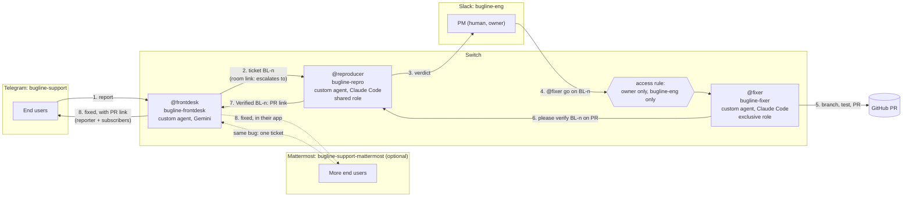

# Bugline

[](https://github.com/Ishaan2053/bugline/actions/workflows/ci.yml) [](https://github.com/Ishaan2053/bugline/releases/latest) [](LICENSE) [](https://www.python.org/downloads/)

Users report bugs in the chat they already use; the team fixes them in the chat they already use;
Switch carries the work across, keeps a human in charge, and closes the loop back to the reporter.
A user writes `@frontdesk` in a Telegram group. A complete bug report crosses into a Slack channel
as ticket `BL-n`. A coding agent reproduces it. Only the PM can tell a second coding agent to fix
it. The fixer opens a pull request, another agent verifies it, and the front desk tells everyone
who reported the bug, back in their own chat, with the link. All of this ran live on Nov 4, 5
and 6, 2026 (a second support room on Mattermost on Nov 6); the numbers are below.

<!-- TODO(author): hero.gif, Telegram and Slack side by side, one full loop -->

Built for the Flip the Switch Hackathon (WeMakeDevs x DevTools Academy x Switch), Track 01 "Best
Business Workflow".

<!-- TODO(author): video link -->

## Why this stops working without Switch

Take Switch away and the two chats have no way to reach each other, and nothing stands between a
stranger and the agent that pushes code. Each piece below is a Switch primitive, and each one
carries part of the loop:

| Switch primitive | What Bugline uses it for | Without it |
| --- | --- | --- |
| Rooms on two chat apps | `bugline-support` is a Telegram group and `bugline-eng` is a Slack channel, both Switch rooms. The front desk is a member of both. | You write and host a Telegram bot, a Slack bot and a bridge between them, and map users across both. |
| Room links | `bugline-support` "escalates to" `bugline-eng`, which "supports" it back. The front desk finds the eng room through the link and will not start without it, and `bootstrap.py --add-support mattermost` adds another support room with no code change ([how](docs/switch-setup.md#5-run-bootstrap)). | The engineering room's id is hard-coded in the front desk, and each extra support app is another bot to write, host and wire up. |
| Shared role `reproducer` | The front desk's ticket addresses `@reproducer`. Whoever holds the role gets it. | Tickets go to a hard-coded agent name. |
| Exclusive role `fixer` + access rule | The access rule on `bugline-fixer` admits only its owner (the PM), only in `bugline-eng`. When `sam` wrote `@fixer fix BL-2 now`, Switch answered in the fixer's name, "You're not permitted to direct messages to me in this room — my operator has restricted who can address me here.", and the fixer program never saw the message. | The gate is an `if` statement inside the agent, and a prompt can talk its way past it. |
| Targeted messages between agents | Three hand-offs use `send_targeted_message`, which also says whether the target is reachable: front desk to `reproducer` (the ticket), fixer to `reproducer` (verify this PR), reproducer to the front desk (`Verified BL-n`). Only that line, from the reproducer or the room owner, closes a ticket. | Agents poll a shared database or a queue you build, and anyone in the room can close a ticket. |
| Aliases | `bugline-frontdesk` is `@frontdesk` in both rooms. An agent holds one role across all rooms, so a per-room alias is how one agent works two rooms. | Users type internal agent names. |
| Room instructions and the `bugline-kit` package | Each room has its rules from `switch/room-instructions-*.md`, and `bugline-kit` holds `intake-rules.md`, `repro-checklist.md`, `fix-policy.md` and the repo reference. The agents read the kit from Switch before each message or run, so an edit in Switch applies to the next message ([details](docs/switch-setup.md#5-run-bootstrap)). | Every agent's prompt carries its own copy of the rules, and changing a rule means redeploying every agent. |
| Custom agents over the agent protocol | All three agents are programs in this repo that hold one WebSocket per room, and Switch delivers only messages addressed to them. Who may address each one is an access rule stored on the agent in Switch, not in its code. | You build the addressing, the per-room connections, the presence and the refusals yourself. |
| Room template | `switch/bugline.template.yaml` creates `bugline-eng`, its Slack channel, the roles, the alias and the repo reference in one server call. `switch/bugline-support.template.yaml` does the same for a support room on any app where Switch can create channels (not Telegram). | You click through the room, channel, roles and reference by hand. |

## Architecture

Two rooms on two chat apps, linked in Switch; three agents; one human gate; the answer goes back
to the person who asked.



The front desk (`agents/frontdesk`) is a member of every room and holds one WebSocket per room.
The reproducer and the fixer are one program, `agents/coder`, started twice with a different
`CODER_ROLE`; for each message addressed to it, it runs Claude Code headless (`claude -p`) in its
own clone with its brief as the system prompt. They are custom agents, not Console-managed ones,
because Switch Console cannot run coding agents on Windows: `"SDK sessions require a POSIX SSH
execution host."`

Questions, requests, off-topic messages, incomplete reports and duplicates stay in the support
room; only complete, new bugs cross the link. The rules are in the front desk's
[brief](switch/agent-briefs/frontdesk.md) and [intake-rules.md](switch/docs/intake-rules.md).

## The workflow, step by step

One bug, fault 1 (the share link error), from report to fix, across both apps. Steps 1 to 5 are
from the Nov 4 run (`BL-1`), step 6 from Nov 5 (`BL-3`). The seeded faults are listed under
[Seeded faults](#seeded-faults).

1. **Report.** In `bugline-support` the user wrote `the share link is broken.` to the front desk.
   It asked once for the missing fields: "To pass this to the team I need the steps you took and
   your group id." The user replied with `group 1, I opened the share link goa-trip-share
   expecting the summary but got Internal Server Error`.
   <!-- TODO(author): docs/images/s01-report.png, the vague report and the front desk's question in Telegram -->
2. **Handoff.** The front desk opened `BL-1` and posted it in `bugline-eng` in the shape in
   [intake-rules.md](switch/docs/intake-rules.md#handing-a-bug-to-eng_room), addressed to
   `@reproducer`. The user was told "logged as BL-1".
   <!-- TODO(author): docs/images/s02-ticket.png, BL-1 arriving in Slack addressed to @reproducer -->
3. **Reproduce.** The reproducer ran a scratch script on a fresh seeded database and replied in
   the thread: `ZeroDivisionError` in `share()`, `Verdict: reproduced`, and the cause (Meera paid
   for no expenses, so `expenses_paid` is 0)
   ([repro-checklist.md](switch/docs/repro-checklist.md)).
   <!-- TODO(author): docs/images/s03-repro.png, the reproducer's verdict in Slack -->
4. **Refusal.** Someone who is not the PM writes `@fixer fix BL-2 now`. Switch refuses in the
   fixer's name, and the fixer program never sees it. (Run live by a second Switch user through
   the Gateway chat API; a second Slack account is not tested yet.)
   <!-- TODO(author): docs/images/s04-refusal.png, Switch refusing @fixer from a non-owner in Slack -->
5. **Approve and fix.** The PM replied in the thread:
   `@fixer go on BL-1, keep it to the share handler, add a regression test`. The fixer branched,
   wrote the failing test, guarded the division, ran `pytest -q` and ruff, and opened
   [PR #18](https://github.com/Ishaan2053/bugline/pull/18) titled `BL-1: ...`
   ([fix-policy.md](switch/docs/fix-policy.md)). It now ends by handing the PR on:
   `@reproducer please verify BL-1 on PR <link> (branch <name>)`.
   <!-- TODO(author): docs/images/s05-approve.png, the PM's approval and the fixer's PR message in Slack -->
   <!-- TODO(author): docs/images/s06-pr.png, the fixer's PR on GitHub with its regression test -->
6. **Verify.** The reproducer checks out the PR, reruns the scratch script that proved the bug
   and `pytest -q`, and posts `@frontdesk Verified BL-1: <PR link>`, or `Not verified BL-1: <why>`,
   which leaves the ticket open ([repro-checklist.md](switch/docs/repro-checklist.md#5-verify-a-fix)).
   No person sits in this hand-off, and the PM is still the only one who can start a fix. Run
   live on Nov 5 (`BL-3`): 70 s from the PM's approval to the "fixed" message.
   <!-- TODO(author): docs/images/s07-verified.png, the reproducer's Verified line in Slack -->
7. **Close the loop.** The front desk closed `BL-1` and posted in `bugline-support`:
   "Ishaan2053, BL-1 is fixed: https://github.com/Ishaan2053/bugline/pull/18". For `BL-2`, a
   second user's duplicate report was matched to it, and both reporters got the message.
   `@frontdesk status` in `bugline-eng` shows who closed each ticket. If the problem comes back,
   anyone waiting on the ticket replies `still broken`; the front desk reopens it and hands it to
   `@reproducer` again, with no model call (run live on Nov 5).
   <!-- TODO(author): docs/images/s08-fixed-telegram.png, "BL-1 is fixed" landing with the reporter in Telegram -->
   <!-- TODO(author): docs/images/s11-status.png, @frontdesk status in Slack -->

**Ask the reporter.** The PM can write `@frontdesk ask BL-1: which browser were you on?` in the
ticket's thread. The front desk posts the question in the reporter's Telegram thread, and the
reporter's next message comes back into that Slack thread, word for word, with no model call. The
PM and the reporter never share a chat app. Run live on Nov 5 on `BL-3`.

**Any language.** On Nov 5, `sam` wrote "bhai share link kholte hi error aa raha hai"; the front
desk asked for the group id in Hinglish, and `BL-4` reached Slack in English with "Reporter: sam
(bugline-support, wrote in Hinglish)". Each translated reply costs one lite-model call.

**More support rooms, on more apps.** `scripts/bootstrap.py --add-support mattermost` makes
`bugline-support-mattermost` and links it to `bugline-eng` like the first; the front desk finds it
at start through the "supports" link. Run live on Nov 6: Admin reported fault 1 in Telegram
(`BL-1`), and `sam`'s report of the same bug in Mattermost got "Already tracked as BL-1", with
nothing new in Slack. After the PM's approval, fixer PR, `Verified` and close took 78 s, and "BL-1
is fixed" went to Admin in Telegram and to `sam` in Mattermost, each in their own thread.
<!-- TODO(author): docs/images/s09-duplicate-mattermost.png, "Already tracked as BL-1" in Mattermost -->
<!-- TODO(author): docs/images/s10-fixed-mattermost.png, "BL-1 is fixed" with the Mattermost reporter -->

**More approvers.** `approvers = ["sam.k"]` in `bugline.toml` `[rooms]` and one bootstrap run let
`sam.k` tell `@fixer` to go as well, still only in `bugline-eng`. Switch enforces it: the fixer's
code has no list of names. Unit-tested; not yet run live.

The quiet paths (a question answered from the user guide, a request, a vague report, a duplicate,
an off-topic message, a burst of messages, a report the reproducer could not reproduce) all ran
live too. The exact messages are in
[switch-setup.md, smoke run](docs/switch-setup.md#smoke-run-the-seeded-paths).

## Reproduce it

Part A runs from a fresh clone with Docker and Python. Part B needs a Switch server, a Telegram bot
and a Slack app of your own; the chat-app steps are manual, and one script does the rest. Without
Telegram or Slack, the [Mattermost variant](docs/switch-setup.md#mattermost-only-no-telegram-or-slack)
uses the Mattermost that Switch Console bundles (one full loop run on Nov 5).
[docs/switch-setup.md](docs/switch-setup.md) walks through part B in full.

### Prerequisites

- Git and Docker with Compose v2
- Python 3.14
- For part B: Switch Console with its local server running (tested with Console 0.40.1 and server
  0.31.0 on Windows 11), Claude Code signed in (`claude`), the GitHub CLI signed in
  (`gh auth login`), a Telegram account, a Slack workspace you own, and a Google AI Studio key

### Part A: the demo app and the tests

Clone the repo and start the demo app, an expense splitter with seeded faults
([Seeded faults](#seeded-faults)).

PowerShell:

```powershell
git clone https://github.com/Ishaan2053/bugline.git
cd bugline
docker compose up --build -d
curl.exe -s http://localhost:8000/health
curl.exe -s http://localhost:8000/groups/1/balances
curl.exe -s http://localhost:8000/groups/1/settle
curl.exe -s -i http://localhost:8000/share/goa-trip-share
```

Bash:

```bash
git clone https://github.com/Ishaan2053/bugline.git
cd bugline
docker compose up --build -d
curl -s http://localhost:8000/health
curl -s http://localhost:8000/groups/1/balances
curl -s http://localhost:8000/groups/1/settle
curl -s -i http://localhost:8000/share/goa-trip-share
```

What you should see:

```text
{"status":"ok"}
{"group_id":1,"total_spent":9100.0,"members":[{"member_id":1,"name":"Asha","paid":5500.0,"owes":2933.33,"net":2566.67},{"member_id":2,"name":"Ravi","paid":3600.0,"owes":2933.33,"net":666.67},{"member_id":3,"name":"Meera","paid":0.0,"owes":3233.33,"net":-3233.33}]}
{"group_id":1,"transfers":[{"from":"Meera","to":"Asha","amount":2566.67},{"from":"Meera","to":"Ravi","amount":666.66}]}
HTTP/1.1 500 Internal Server Error
```

The 500 on the share link is fault 1, planted on purpose (`ZeroDivisionError` in
`docker compose logs demo-app`). The `owes` values add up to 9099.99 of 9100.00 spent: that is
fault 2. Stop the app with `docker compose down`.

**Docker images.** Each tagged release (from `v0.1.0`) publishes the demo app and front desk
images to the GitHub Container Registry; the compose file still builds from source. The demo app
image runs on its own:

```bash
docker run --rm -p 8000:8000 ghcr.io/ishaan2053/bugline-demo-app:0.1.0
```

The front desk image needs a clone: it reads `bugline.toml` and the intake rules from the repo,
mounted at `/repo` as in `docker-compose.yml`, and its settings from `agents/frontdesk/.env`:

```bash
docker run --rm --env-file agents/frontdesk/.env -v "$PWD:/repo:ro"   -e BUGLINE_CONFIG=/repo/bugline.toml   -e FRONTDESK_INTAKE_RULES=/repo/switch/docs/intake-rules.md   ghcr.io/ishaan2053/bugline-frontdesk:0.1.0
```

#### Seeded faults

Planted on purpose, one per path through the agents. Do not fix them outside a demo run. Pull
requests #18 and #19 fix faults 1 and 2 and stay open and unmerged on purpose: the demo needs the
faults.

| # | Fault | What the user sees | Path |
| --- | --- | --- | --- |
| 1 | `GET /share/{token}` divides by a member's expense count | "Share link gives an error" (500) | front desk → reproducer → PM approves → fixer PR → verified → reporter told |
| 2 | An equal split rounds each share and drops the leftover paisa | Balances `owes` add up to 9099.99 of 9100.00 | the reproducer shows the exact numbers |
| 3 | Not a bug: an expense entered with the wrong payer | "It says I owe money I already paid" | the front desk answers from the user guide; nothing is escalated |
| 4 | A report with no steps or group id | a vague complaint | the front desk asks for exactly the missing fields |
| 5 | A second user reports fault 1 while `BL-1` is open | "Share link broken for me too" | matched to `BL-1`; both reporters are told when it closes |
| 6 | Off-topic | anything unrelated | one polite line, then silence in that thread |

Run the tests. PowerShell, from the repo root (the demo app first, then the front desk):

```powershell
cd demo-app
py -3.14 -m venv .venv; .\.venv\Scripts\Activate.ps1
pip install -r requirements-dev.txt; pytest -q; deactivate
cd ..\agents\frontdesk
py -3.14 -m venv .venv; .\.venv\Scripts\Activate.ps1
pip install -r requirements-dev.txt; pytest -q
python agent.py --help
```

Bash:

```bash
cd demo-app
python3.14 -m venv .venv && source .venv/bin/activate
pip install -r requirements-dev.txt && pytest -q; deactivate
cd ../agents/frontdesk
python3.14 -m venv .venv && source .venv/bin/activate
pip install -r requirements-dev.txt && pytest -q
python agent.py --help
```

Expect `8 passed` for the demo app and `95 passed, 1 skipped` for the front desk (the skipped test
calls Gemini and runs only with `BUGLINE_LIVE=1`). `agent.py --help` lists `--register` and
`--list-rooms`. The same `pip install -r requirements-dev.txt` and `pytest -q` work in
`agents/common` (`34 passed`), `agents/coder` (`28 passed`) and `scripts` (`35 passed`).

### Part B: Switch, Telegram and Slack

**Fork first.** The fixer pushes branches and opens PRs, so it needs a repo you can push to.
Fork this repo, set `repo_url` in `bugline.toml` to your fork, use your fork's URL wherever the
steps below clone `Ishaan2053/bugline`, sign in with `gh auth login` as yourself, and create the
label the fixer puts on its PRs: `gh label create demo-app` in the fork. On Windows, bootstrap
reads the server's address and admin login from Switch Console; anywhere else, set
`SWITCH_API_URL`, `SWITCH_ADMIN_EMAIL` and `SWITCH_ADMIN_PASSWORD` before running it.

1. **Chat apps, by hand.** Make a Telegram bot with group privacy off and a group named
   `bugline-support`; connect the bot in Switch Console, add it to the group and post one
   message so the room appears. Make a Slack app from Switch's manifest and connect it. Link your
   own Telegram and Slack accounts in Console. Details:
   [switch-setup.md part A](docs/switch-setup.md#part-a-the-chat-apps-by-hand).
2. **Agent folders.** Make the two venvs, put your Gemini key in the front desk's `.env`, and clone
   the repo once for each coder (each clone needs the demo app's venv, so the agents can run its
   tests):

   ```powershell
   cd agents\frontdesk; py -3.14 -m venv .venv; .\.venv\Scripts\pip install -r requirements.txt
   Copy-Item .env.example .env   # set GEMINI_API_KEY; bootstrap fills in the rest
   cd ..\coder; py -3.14 -m venv .venv; .\.venv\Scripts\pip install -r requirements.txt
   cd ..\..
   git clone https://github.com/Ishaan2053/bugline.git C:\bugline-agents\bugline-repro\bugline
   git clone https://github.com/Ishaan2053/bugline.git C:\bugline-agents\bugline-fixer\bugline
   # in each clone's demo-app\: py -3.14 -m venv .venv; .\.venv\Scripts\pip install -r requirements-dev.txt
   ```

   ```bash
   cd agents/frontdesk && python3.14 -m venv .venv && .venv/bin/pip install -r requirements.txt
   cp .env.example .env   # set GEMINI_API_KEY; bootstrap fills in the rest
   cd ../coder && python3.14 -m venv .venv && .venv/bin/pip install -r requirements.txt
   cd ../..
   git clone https://github.com/Ishaan2053/bugline.git ~/bugline-agents/bugline-repro/bugline
   git clone https://github.com/Ishaan2053/bugline.git ~/bugline-agents/bugline-fixer/bugline
   # in each clone's demo-app/: python3.14 -m venv .venv && .venv/bin/pip install -r requirements-dev.txt
   ```

3. **Everything else in Switch, one command.** From the repo root:

   ```powershell
   agents\frontdesk\.venv\Scripts\python scripts\bootstrap.py --dry-run
   agents\frontdesk\.venv\Scripts\python scripts\bootstrap.py
   ```

   ```bash
   agents/frontdesk/.venv/bin/python scripts/bootstrap.py --dry-run
   agents/frontdesk/.venv/bin/python scripts/bootstrap.py
   ```

   It registers the three agents, makes `bugline-eng` from the template, sets the access rules,
   room instructions, links, aliases and `bugline-kit`, and fills in both `.env` files. It prints
   `created`, `updated`, `exists` or `skipped (why)` for each thing, so it is safe to run again
   ([what it does, in order](docs/switch-setup.md#5-run-bootstrap)). Optional:
   `--add-support mattermost` and `approvers` in `bugline.toml`
   ([more support rooms and approvers](docs/switch-setup.md#more-support-rooms-and-approvers)).
4. **Start the agents and quiet the rooms.** One terminal each:

   ```powershell
   cd agents\frontdesk; .\.venv\Scripts\python agent.py
   cd agents\coder; $env:CODER_ROLE = "reproducer"; .\.venv\Scripts\python agent.py
   cd agents\coder; $env:CODER_ROLE = "fixer"; .\.venv\Scripts\python agent.py
   ```

   ```bash
   cd agents/frontdesk && .venv/bin/python agent.py
   cd agents/coder && CODER_ROLE=reproducer .venv/bin/python agent.py
   cd agents/coder && CODER_ROLE=fixer .venv/bin/python agent.py
   ```

   Then type `!follow-ups off` in both rooms, so agents act only when named.
5. **Check.** With the agents running, `doctor.py` prints one PASS or FAIL line for each thing the
   demo needs: server, bridges, rooms, agent connections, links, kit documents, keys, roles,
   access rules, `claude`, `gh`, `git` and the clones.

   ```powershell
   agents\frontdesk\.venv\Scripts\python scripts\doctor.py
   ```

   ```bash
   agents/frontdesk/.venv/bin/python scripts/doctor.py
   ```

   To start again from `BL-1`, stop the agents and run `scripts/reset_demo.py --dry-run`, then
   without `--dry-run`. It deletes the tickets, resets both coder clones to `origin/main`, closes
   ticket PRs except `--keep` (default #18 and #19), and recreates the demo app's container.
   Console's agent list does not show Bugline's agents; that is expected
   ([troubleshooting](docs/switch-setup.md#troubleshooting)).
6. Run the seeded paths in
   [switch-setup.md, smoke run](docs/switch-setup.md#smoke-run-the-seeded-paths).

## The agents

Three agents, one job each. Switch, not the agents, decides who may instruct each one.

| Agent | Addressed as | Runtime | Switch role | Who may instruct it | Brief |
| --- | --- | --- | --- | --- | --- |
| `bugline-frontdesk` | `@frontdesk` (alias in both rooms) | Custom Python agent over the Switch agent protocol ([agents/frontdesk](agents/frontdesk/README.md)); Gemini through `google-genai` | none (an alias, since an agent holds one role across all rooms) | Anyone | [frontdesk.md](switch/agent-briefs/frontdesk.md) |
| `bugline-repro` | `@reproducer`, `@bugline-repro` | Custom Python agent ([agents/coder](agents/coder/README.md), `CODER_ROLE=reproducer`) that runs Claude Code headless in its own clone | `reproducer`, shared | Its owner (the PM) and the owner's agents, so the front desk (tickets) and the fixer (PRs to verify) | [reproducer.md](switch/agent-briefs/reproducer.md) |
| `bugline-fixer` | `@fixer`, `@bugline-fixer` | The same program with `CODER_ROLE=fixer` | `fixer`, exclusive | Its owner (the PM), plus any `approvers` in `bugline.toml`, in `bugline-eng` only | [fixer.md](switch/agent-briefs/fixer.md) |

The coders run Claude Code with `--permission-mode dontAsk`, a per-role allow list and a deny list
(the reproducer cannot commit, push or call `gh`; neither can force-push, push `main` or merge).
[agents/coder/README.md](agents/coder/README.md) lists every rule and why.

## The problem this solves for a real team

A small product team gets bug reports where its users are, not where its engineers are: a support
WhatsApp or Telegram group, while engineering works in Slack. Today someone copies each report
across by hand, asks the user for the missing details, and forgets to tell them when it is fixed.
Bugline moves only complete, new bugs across, gives each one a ticket id and a reproduction before
a person looks at it, keeps the decision to change code with one named person, and tells every
reporter when the fix is up. The demo app is an expense splitter, but the agents and scripts take
its names from one file, `bugline.toml`; [docs/own-repo.md](docs/own-repo.md) says what to change.

What a loop cost, from `agents/frontdesk/calls.log` and the coder logs:

| Loop | Front desk Gemini calls | Claude Code runs | Verify | Report to "fixed" in Telegram |
| --- | --- | --- | --- | --- |
| `BL-1` (fault 1) | 2 (`gemini-3.5-flash-lite`, 3,053 tokens): the vague report, then the complete one | 3: reproducer 22 s (refused, see below), reproducer again 26 s, fixer 55 s | not in this run | 16 min 57 s, most of it the permission fix and restart between the two reproducer runs |
| `BL-2` (fault 2) | 1 to open it, 2 more for the second user's duplicate (classify, duplicate check) | 2: reproducer 24 s, fixer 51 s | not in this run | 2 min 25 s, both reporters told |
| `BL-3` (fault 1, Nov 5) | 2 | 3: reproduce, fix, verify | `Verified` by the reproducer | 70 s from the PM's approval |
| `BL-5` (fault 2, Nov 5) | 2 (classify, duplicate check), after two HTTP 503s that the front desk waited out | 4: reproduce (the report's numbers were wrong: "not reproduced"), again on the PM's pointer, fix, verify | `Verified` by the reproducer | 78 s from the PM's approval |

`BL-1` and `BL-2` ran before the verify step existed; it adds one Claude Code run and no Gemini
call. The Nov 4 smoke run, every seeded path, took 13 Gemini calls. The target was under 25 per
loop.

## What the agents got wrong and how the briefs fixed it

From the live runs on Nov 4 to 6:

- **The reproducer could not run a single command.** Its first try at `BL-1` replied "every
  command, even `git status`, was refused": in `dontAsk` mode every part of a chained shell
  command must be on the allow list, and ours listed single commands. The coders now allow `Bash`
  and keep each role in its lane with deny lists; the retry reproduced `BL-1` in 26 seconds.
- **The plan assumed Console features Windows does not have.** Console cannot run coding agents
  there (every provider showed "Not supported here"), so the coders became custom protocol
  agents ([Architecture](#architecture)). It serves no Gateway web UI either, so every setup step
  after the chat apps goes through the Gateway API, in `scripts/bootstrap.py`.
- **A typo reached nobody.** Slack's free plan gives agents no `@` autocomplete, and `@repoducer`
  went nowhere without an error. Names must be typed exactly.
- **The front desk replied in the wrong thread.** It used the id of the message that addressed it,
  not the thread's root, so a reply to a reply left the ticket's thread. It now uses the root.
- **A refusal woke the reproducer.** The front desk's reply "Only @reproducer or the room owner
  can close a ticket" named the role, so Switch addressed the reproducer and it started a run for
  nothing. The front desk's replies no longer name a role, and a test checks every one.
- **The reproducer could not write its scratch script.** Claude Code reads a relative path rule
  against the shell's current directory, so after `cd demo-app` the write rule stopped matching.
  The rules are now absolute paths under each clone, checked with the real command line.
- **A busy model meant silence.** Gemini answered 503 "high demand", and only 429 was retried, so
  the reporter got no reply. 503 is now waited out the same way (twice on `BL-5`, unseen by the
  user), and any other error gets "Something went wrong on my side".
- **A server restart replayed old approvals.** On Nov 6 Switch's own database restarted and sent
  every agent its whole history, including old `@fixer go` messages; the fixer ran none of them.
  An agent now ignores a message more than 30 minutes old and any message it already handled, and
  a connection with nothing delivered yet starts at the newest message.

What reading the Switch docs and server source changed before the first run is in
[switch-setup.md](docs/switch-setup.md#what-the-switch-docs-and-server-source-changed). The
day-by-day record is in [docs/build-journal.md](docs/build-journal.md).

## Repo layout

```text
bugline.toml         the project the agents work on: repo, paths, test command, report fields, names
demo-app/            FastAPI + SQLite expense splitter with seeded faults, tests, Dockerfile
agents/common/       shared by all three agents: Switch protocol client, ticket id format, .env
                     loading, project.py (reads bugline.toml and fills the switch/ placeholders)
agents/frontdesk/    the front desk: handlers, Gemini calls and prompts, SQLite store, Dockerfile
agents/coder/        the reproducer and the fixer: one program that runs Claude Code headless
switch/              room templates, room instructions, docs/ (the bugline-kit documents), agent-briefs/
scripts/             bootstrap.py: everything in Switch after the chat-app connections, idempotent;
                     doctor.py: checks before a recording; reset_demo.py: back to BL-1
docs/                switch-setup.md (Switch walkthrough, other chat apps, troubleshooting),
                     own-repo.md, build-journal.md
.github/             workflows/ci.yml, workflows/release.yml, dependabot.yml
docker-compose.yml   demo app; front desk under the `agents` profile
CLAUDE.md, AGENTS.md instructions for the coding agents used to build this repo; Bugline's own
                     agents do not read them
```

## Tests and CI

[`ci.yml`](.github/workflows/ci.yml) runs on every pull request and on `main`. Its `test` job runs
`ruff format --check`, `ruff check` and `pytest -q` for each of the five Python projects on Python
3.14.7; the `docker` job builds both images and checks that the demo app answers `/health` and
`/groups/1/balances` under Compose; the `docs` job checks every relative link and anchor in the
Markdown files, offline. [`release.yml`](.github/workflows/release.yml) runs on a `v*.*.*` tag:
the same checks, then the two images for amd64 and arm64 to GHCR, then a GitHub Release with
generated notes. Dependabot opens grouped monthly updates. The tests that would catch faults 1
and 2 are left out on purpose; the fixer adds them during the demo.

## Limits and next steps

- The second user in the live runs (`sam`) posted through the Gateway chat API, not from a second
  Telegram or Slack account. The refusal wording for an unlinked chat account may differ
  ([switch-setup.md](docs/switch-setup.md#troubleshooting)), and `approvers` is not yet run live.
- The limit of 5 open tickets per user is unit-tested but was not hit in a live run.
- An agent that was down for more than 30 minutes does not answer the messages sent meanwhile
  (its log names them). That is the cost of the replay guard above.
- `scripts/bootstrap.py` set up a second copy from nothing on Nov 5 (new agents, rooms, rules,
  links and kit, on [Mattermost](docs/switch-setup.md#mattermost-only-no-telegram-or-slack)), but
  on a server that already had the demo, not on a newly installed Switch.
- The front desk's Docker service is not verified against Console's native server, which listens
  on 127.0.0.1 only; run the front desk natively, as in part B.
- Only tested on Windows 11 with Console 0.40.1. On macOS or Linux, Console could run the coders
  as managed agents instead; that path is not tested.
- A role mention reaches a coder only while its program is running and holds the role. The front
  desk says so in the ticket's thread when `send_targeted_message` reports no live target.
- After `ask`, the reporter's next message to the front desk is taken as the answer, wherever they
  post it. Naming the ticket (`BL-2: ...`) picks which question it answers.
- Feature requests are logged, not handed over; the PM reads them with `@frontdesk requests`.
  Turning one into planned work is up to the PM.

## Licence and credits

MIT, see [LICENSE](LICENSE).

Built on [Switch](https://github.com/sandbox-quantum/switch), for the
[Flip the Switch Hackathon](https://www.wemakedevs.org/hackathons/switch) run by WeMakeDevs. The
front desk uses Google [Gemini](https://ai.google.dev/) through `google-genai`; the coders run
[Claude Code](https://docs.claude.com/en/docs/claude-code/overview) headless. The demo app uses
[FastAPI](https://fastapi.tiangolo.com/). The room template follows the shape of the official
example templates in the Switch repo.
