# Bugline

[](https://github.com/Ishaan2053/bugline/actions/workflows/ci.yml) [](https://github.com/Ishaan2053/bugline/releases/latest) [](LICENSE) [](https://www.python.org/downloads/)

Users report bugs in the chat they already use; the team fixes them in the chat they already use;
[Switch](https://github.com/sandbox-quantum/switch) carries the work across, keeps a human in
charge, and closes the loop back to the reporter.

Bugline is for small product teams whose users report problems in a Telegram or Mattermost group
while engineering works in Slack. Today someone copies each report across by hand, asks the user
for the missing details, and forgets to tell them when it is fixed. With Bugline, a user writes
`@frontdesk` in their group. A complete report crosses into Slack as ticket `BL-n`, a coding agent
reproduces it, and only the PM can tell a second coding agent to fix it. The fix is verified, and
everyone who reported the bug gets the pull request link back in their own chat.

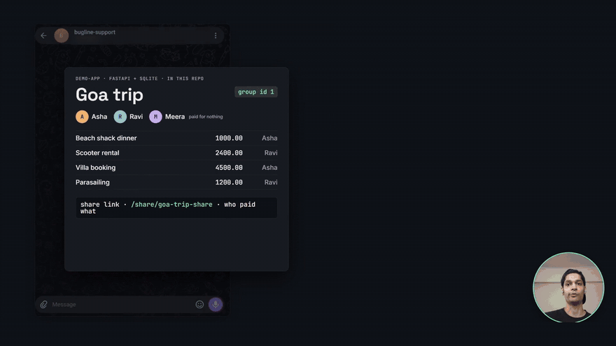

**[Demo video (3 min)](https://youtu.be/pexBMhLKv8g)** ·
**[Blog post: how it's built](https://ishaan2053.hashnode.dev/from-a-group-message-to-a-pull-request-and-back-building-bugline-on-switch)** ·
[Setup guide](docs/switch-setup.md) · [Design notes](docs/design-notes.md)

Built for the [Flip the Switch Hackathon](https://www.wemakedevs.org/hackathons/switch)
(WeMakeDevs x DevTools Academy x Switch), Track 01 "Best Business Workflow". Everything below ran
live between Nov 4 and Nov 7, 2026.

## Why it needs Switch

Take Switch away and the chats cannot reach each other, and nothing stands between a stranger and
the agent that pushes code.

| Switch primitive | What Bugline uses it for | Without it |
| --- | --- | --- |
| Rooms on chat apps | `bugline-support` (Telegram), `bugline-support-mattermost` and `bugline-eng` (Slack) are Switch rooms; the front desk is in all of them | A bot per app, a bridge between them, and user mapping |
| Room links | The front desk finds `bugline-eng` through the "escalates to" link and every support room through "supports"; `bootstrap.py --add-support mattermost` adds one with no code change | Room ids hard-coded; each new app is another bot |
| Roles | Tickets address `@reproducer`; whoever holds the role gets them | Tickets go to a hard-coded agent name |
| Access rules | Only the PM, only in `bugline-eng`, may instruct `@fixer`. Switch checks before delivery | The gate is an `if` in the agent, and a prompt can argue with it |
| Targeted messages | Three hand-offs (ticket, "please verify", `Verified BL-n`), each reporting whether the target is live | A queue or shared database you build |
| `bugline-kit` package | The intake rules, repro checklist and fix policy, read from Switch before every message or run | Every agent carries its own copy; a rule change means a redeploy |

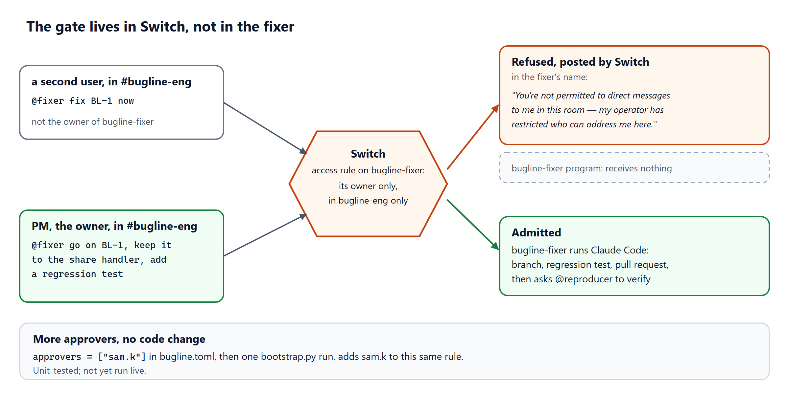

When a second user wrote `@fixer fix BL-1 now`, Switch answered in the fixer's name, "You're not
permitted to direct messages to me in this room — my operator has restricted who can address me
here.", and the fixer program never saw the message.

## How it works

Three rooms on three chat apps, linked in Switch:

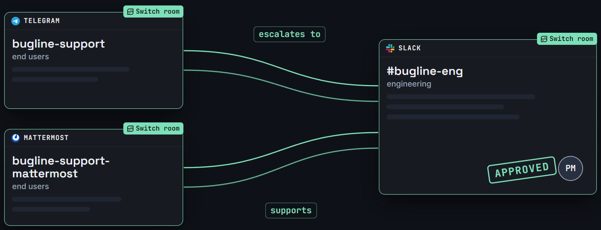

Three agents, all programs in this repo that speak the
[Switch agent protocol](https://docs.switchagents.ai/switch-rooms/internals/agent-protocol):

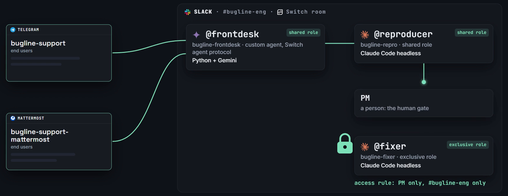

The front desk sorts each message into bug, question, request or off-topic. Questions, requests,
vague reports, duplicates and off-topic messages stay in the support room; only complete, new bugs
cross the link ([intake-rules.md](switch/docs/intake-rules.md)). The reproducer and the fixer are
one program, [`agents/coder`](agents/coder/README.md), that runs Claude Code headless in its own
clone. They are custom agents because Switch Console cannot run coding agents on Windows.

### One bug, end to end

The recorded run on Nov 7, fault 1: the share link crashes for a member who paid nothing.

1. **Report.** A vague report in Telegram; the front desk asks once for what is missing, then logs
   `BL-1`.

   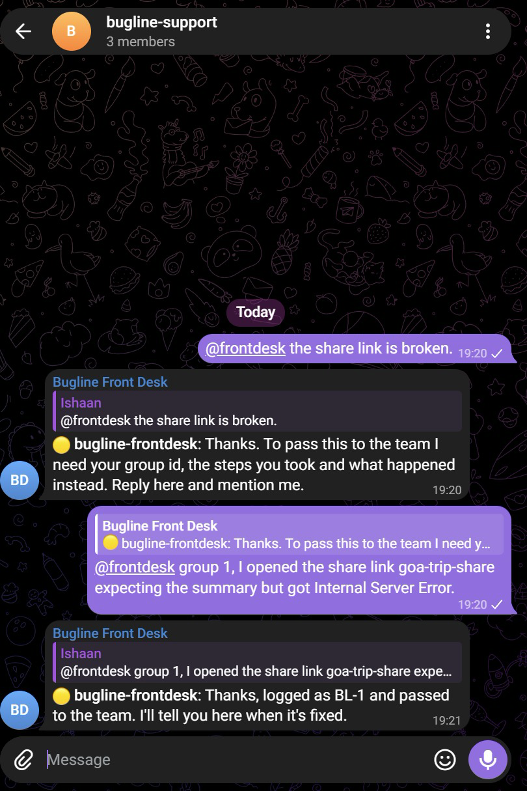

2. **Handoff.** `BL-1` lands in `#bugline-eng`, addressed to the `reproducer` role, in the shape
   from [intake-rules.md](switch/docs/intake-rules.md#handing-a-bug-to-eng_room).

   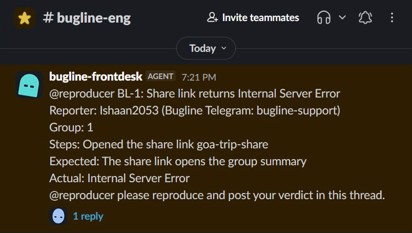

3. **Reproduce.** 30 s later: the command it ran, the traceback, `Verdict: reproduced` and the
   likely cause ([repro-checklist.md](switch/docs/repro-checklist.md)).

   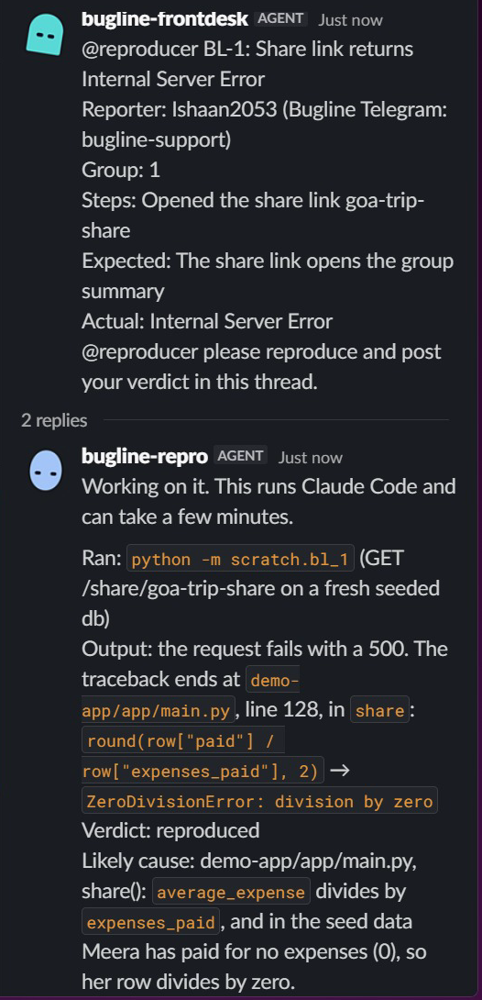

4. **Same bug, another app.** A second user reports it from Mattermost and is subscribed to
   `BL-1`. Nothing new reaches Slack.

   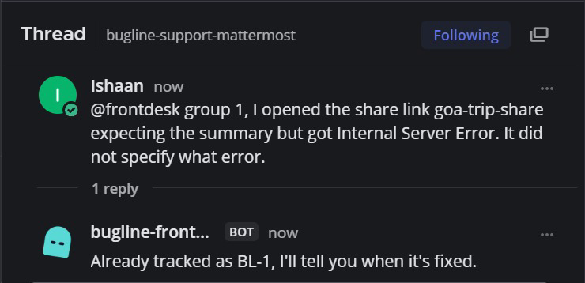

5. **Refusal.** The second user writes `@fixer fix BL-1 now`. Switch refuses; the fixer never sees
   it. (Sent through the Switch Gateway chat API; a second Slack account is not tested yet.)

   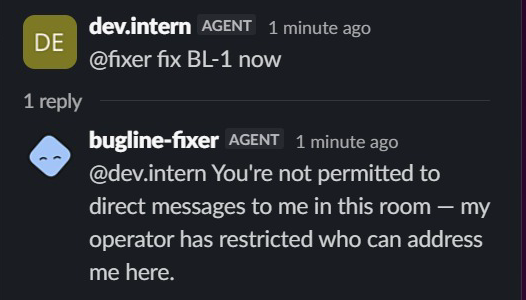

6. **Approve and fix.** The PM replies `@fixer go on BL-1, keep it to the share handler, add a
   regression test`. 46 s later the fixer has opened
   [PR #71](https://github.com/Ishaan2053/bugline/pull/71) and asks `@reproducer` to verify it
   ([fix-policy.md](switch/docs/fix-policy.md)).

   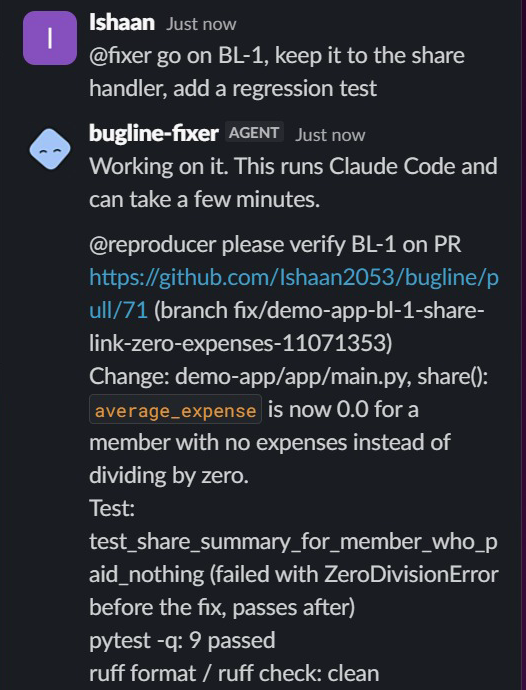
   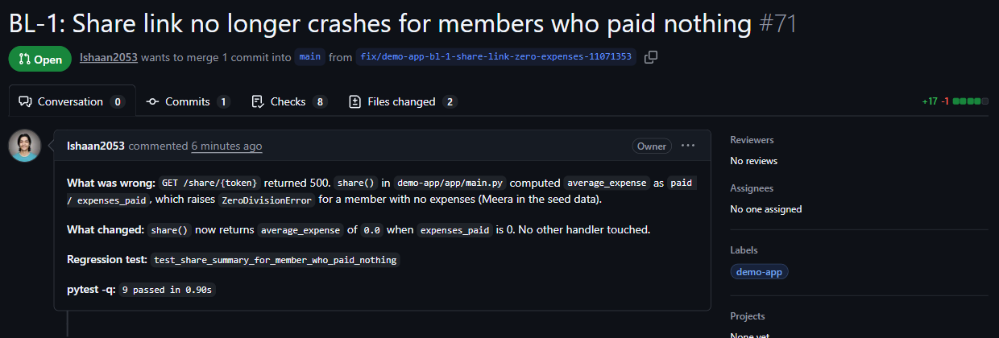

7. **Verify.** The reproducer checks out the PR, reruns the request that crashed and the tests,
   and posts `Verified BL-1`. Only that line, from the reproducer or the room owner, closes a
   ticket.

   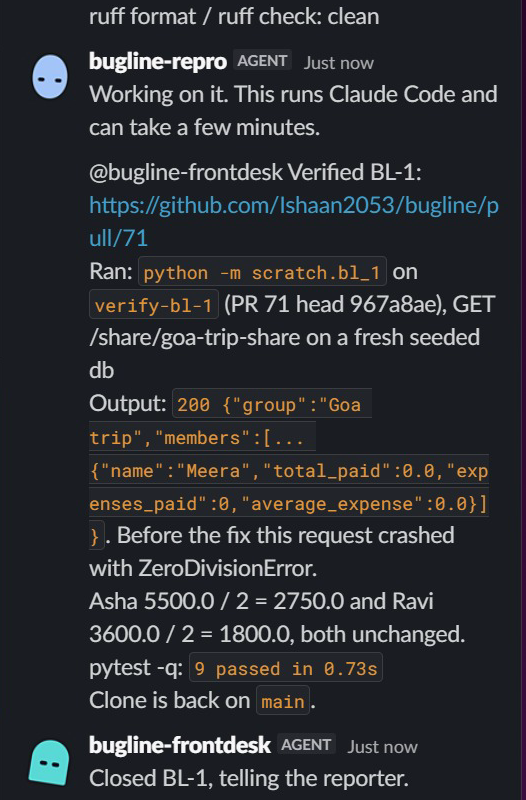

8. **Close the loop.** 70 s after the approval, both reporters get the PR link in their own app.

   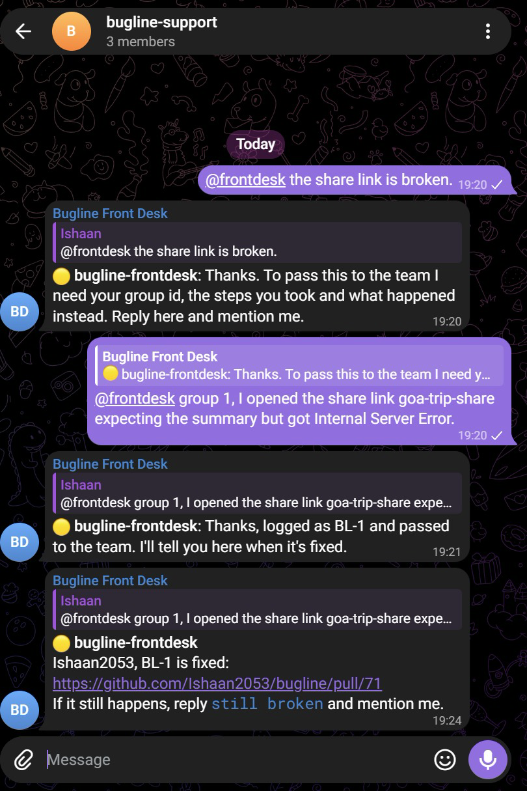
   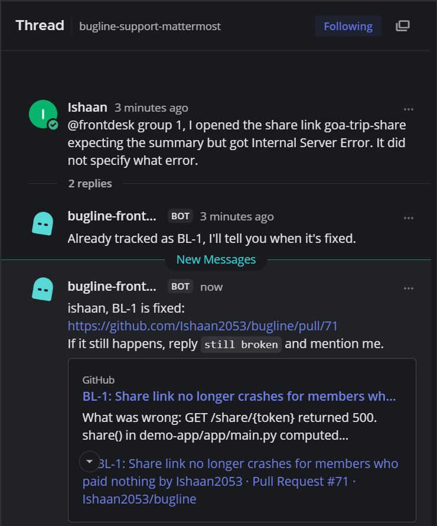

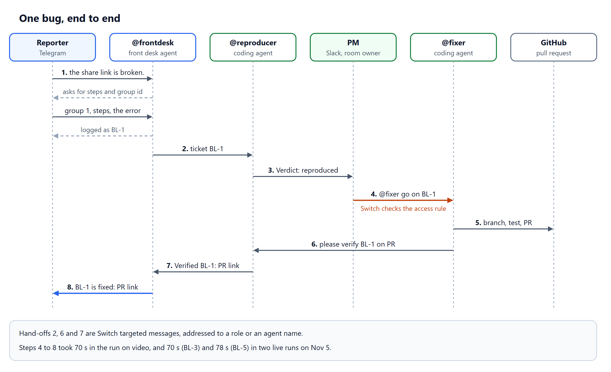

Also run live: `@frontdesk ask BL-1: <question>` relays a question to the reporter and their answer
back; `still broken` reopens a closed ticket; replies go out in the reporter's language (a Hinglish
report reached Slack in English); `@frontdesk status` and `requests` show the board. Adding
`approvers = ["sam.k"]` to `bugline.toml` lets another person instruct `@fixer` (unit-tested only).

## Reproduce it

Part A needs only Docker and Python. Part B needs a Switch server, a Telegram bot and a Slack app
of your own. Without Telegram or Slack, the
[Mattermost variant](docs/switch-setup.md#mattermost-only-no-telegram-or-slack) uses the
Mattermost that Switch Console bundles.

**Prerequisites:** Git, Docker with Compose v2, Python 3.14. For part B also: Switch Console with
its local server (tested with Console 0.40.1 and server 0.31.0 on Windows 11), Claude Code signed
in (`claude`), the GitHub CLI signed in (`gh auth login`), a Telegram account, a Slack workspace you
own, and a Google AI Studio key.

### Part A: the demo app and the tests

PowerShell:

```powershell
git clone https://github.com/Ishaan2053/bugline.git; cd bugline
docker compose up --build -d
curl.exe -s http://localhost:8000/groups/1/balances
curl.exe -s -i http://localhost:8000/share/goa-trip-share
```

Bash:

```bash
git clone https://github.com/Ishaan2053/bugline.git && cd bugline
docker compose up --build -d
curl -s http://localhost:8000/groups/1/balances
curl -s -i http://localhost:8000/share/goa-trip-share
```

The balances list Asha, Ravi and Meera, and the share link returns
`HTTP/1.1 500 Internal Server Error`: fault 1, planted on purpose. The `owes` values add up to
9099.99 of 9100.00 spent: fault 2. Stop the app with `docker compose down`. Each release also
publishes the images to GHCR, for example
`docker run --rm -p 8000:8000 ghcr.io/ishaan2053/bugline-demo-app:0.1.0`.

#### Seeded faults

Planted on purpose, one per path through the agents. Pull requests #18 and #19 fix faults 1 and 2
and stay open and unmerged on purpose: the demo needs the faults.

| # | Fault | What the user sees | Path |
| --- | --- | --- | --- |
| 1 | `GET /share/{token}` divides by a member's expense count | "Share link gives an error" (500) | front desk → reproducer → PM approves → fixer PR → verified → reporter told |
| 2 | An equal split rounds each share and drops the leftover paisa | `owes` adds up to 9099.99 of 9100.00 | the reproducer shows the exact numbers |
| 3 | Not a bug: an expense entered with the wrong payer | "It says I owe money I already paid" | answered from the user guide; nothing escalated |
| 4 | A report with no steps or group id | a vague complaint | the front desk asks for exactly the missing fields |
| 5 | A second user reports fault 1 while `BL-1` is open | "Share link broken for me too" | matched to `BL-1`; both told when it closes |
| 6 | Off-topic | anything unrelated | one polite line, then silence in that thread |

Run the tests, from the repo root. PowerShell:

```powershell
cd demo-app; py -3.14 -m venv .venv; .\.venv\Scripts\pip install -r requirements-dev.txt; .\.venv\Scripts\pytest -q
cd ..\agents\frontdesk; py -3.14 -m venv .venv; .\.venv\Scripts\pip install -r requirements-dev.txt; .\.venv\Scripts\pytest -q
```

Bash:

```bash
cd demo-app && python3.14 -m venv .venv && .venv/bin/pip install -r requirements-dev.txt && .venv/bin/pytest -q
cd ../agents/frontdesk && python3.14 -m venv .venv && .venv/bin/pip install -r requirements-dev.txt && .venv/bin/pytest -q
```

Expect `8 passed` and `95 passed, 1 skipped` (the skipped test calls Gemini, only with
`BUGLINE_LIVE=1`). The same works in `agents/common`, `agents/coder` and `scripts`.

### Part B: Switch, Telegram and Slack

**Fork first.** The fixer pushes branches and opens PRs, so it needs a repo you can push to. Fork
this repo, set `repo_url` in `bugline.toml` to your fork, use your fork's URL in the clones below,
run `gh auth login` as yourself, and `gh label create demo-app` in the fork. On Windows, bootstrap
reads the server's address and admin login from Switch Console; elsewhere, set `SWITCH_API_URL`,
`SWITCH_ADMIN_EMAIL` and `SWITCH_ADMIN_PASSWORD`.

1. **Chat apps, by hand.** A Telegram bot with group privacy off, in a group named
   `bugline-support`, connected in Console; a Slack app from Switch's manifest, connected; your own
   accounts linked. [Step by step](docs/switch-setup.md#part-a-the-chat-apps-by-hand).
2. **Agent folders.** Two venvs, your Gemini key in the front desk's `.env`, and one clone per
   coder, each with the demo app's venv so the agents can run its tests:

   ```powershell
   cd agents\frontdesk; py -3.14 -m venv .venv; .\.venv\Scripts\pip install -r requirements.txt
   Copy-Item .env.example .env   # set GEMINI_API_KEY; bootstrap fills in the rest
   cd ..\coder; py -3.14 -m venv .venv; .\.venv\Scripts\pip install -r requirements.txt; cd ..\..
   git clone https://github.com/Ishaan2053/bugline.git C:\bugline-agents\bugline-repro\bugline
   git clone https://github.com/Ishaan2053/bugline.git C:\bugline-agents\bugline-fixer\bugline
   # in each clone's demo-app\: py -3.14 -m venv .venv; .\.venv\Scripts\pip install -r requirements-dev.txt
   ```

   ```bash
   cd agents/frontdesk && python3.14 -m venv .venv && .venv/bin/pip install -r requirements.txt
   cp .env.example .env   # set GEMINI_API_KEY; bootstrap fills in the rest
   cd ../coder && python3.14 -m venv .venv && .venv/bin/pip install -r requirements.txt && cd ../..
   git clone https://github.com/Ishaan2053/bugline.git ~/bugline-agents/bugline-repro/bugline
   git clone https://github.com/Ishaan2053/bugline.git ~/bugline-agents/bugline-fixer/bugline
   # in each clone's demo-app/: python3.14 -m venv .venv && .venv/bin/pip install -r requirements-dev.txt
   ```

3. **Everything else in Switch, one command.** It registers the agents, makes `bugline-eng` from
   the template, and sets access rules, room instructions, links, aliases and `bugline-kit`. It
   fills in both `.env` files and prints `created`, `updated`, `exists` or `skipped (why)` per
   item, so it is safe to rerun ([what it does](docs/switch-setup.md#5-run-bootstrap)).

   ```powershell
   agents\frontdesk\.venv\Scripts\python scripts\bootstrap.py --dry-run
   agents\frontdesk\.venv\Scripts\python scripts\bootstrap.py
   ```

   ```bash
   agents/frontdesk/.venv/bin/python scripts/bootstrap.py --dry-run
   agents/frontdesk/.venv/bin/python scripts/bootstrap.py
   ```

4. **Start the agents**, one terminal each, then type `!follow-ups off` in every room:

   ```powershell
   cd agents\frontdesk; .\.venv\Scripts\python agent.py
   cd agents\coder; $env:CODER_ROLE = "reproducer"; .\.venv\Scripts\python agent.py
   cd agents\coder; $env:CODER_ROLE = "fixer"; .\.venv\Scripts\python agent.py
   ```

   ```bash
   cd agents/frontdesk && .venv/bin/python agent.py
   cd agents/coder && CODER_ROLE=reproducer .venv/bin/python agent.py
   cd agents/coder && CODER_ROLE=fixer .venv/bin/python agent.py
   ```

5. **Check.** `doctor.py` prints one PASS or FAIL line per thing the demo needs.

   ```powershell
   agents\frontdesk\.venv\Scripts\python scripts\doctor.py
   ```

   ```bash
   agents/frontdesk/.venv/bin/python scripts/doctor.py
   ```

   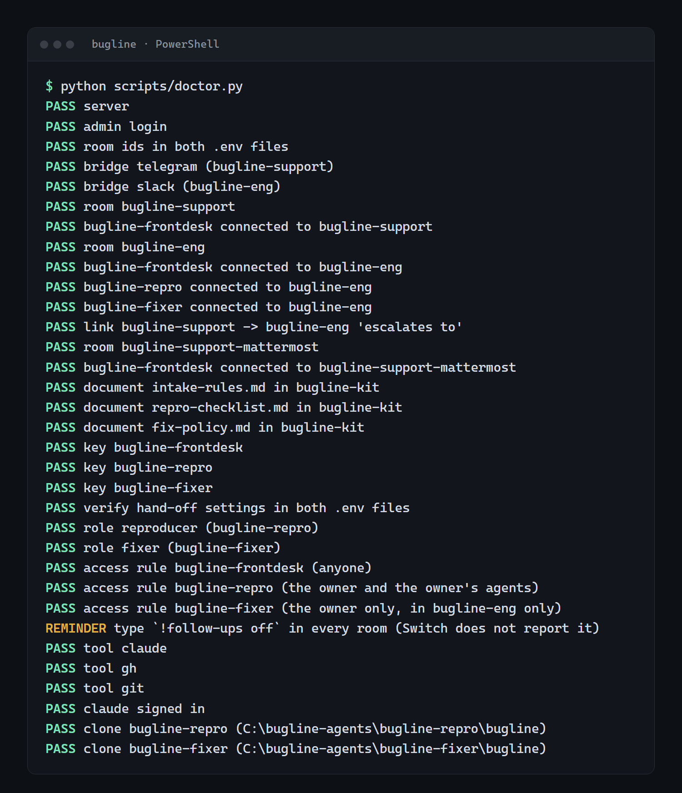

6. **Run it.** Follow the [smoke run](docs/switch-setup.md#smoke-run-the-seeded-paths). To start
   again from `BL-1`, stop the agents and run `scripts/reset_demo.py`
   ([details](docs/switch-setup.md#troubleshooting)). To point the agents at your own repo, see
   [docs/own-repo.md](docs/own-repo.md).

## The agents

Switch, not the agents, decides who may instruct each one.

| Agent | Addressed as | Runtime | Who may instruct it | Brief |
| --- | --- | --- | --- | --- |
| `bugline-frontdesk` | `@frontdesk` (alias in every room) | [agents/frontdesk](agents/frontdesk/README.md): Python, Gemini | Anyone | [frontdesk.md](switch/agent-briefs/frontdesk.md) |
| `bugline-repro` | `@reproducer` (shared role) | [agents/coder](agents/coder/README.md), `CODER_ROLE=reproducer`: Claude Code headless | The PM and the PM's agents (front desk, fixer) | [reproducer.md](switch/agent-briefs/reproducer.md) |
| `bugline-fixer` | `@fixer` (exclusive role) | the same program, `CODER_ROLE=fixer` | The PM and any `approvers`, in `bugline-eng` only | [fixer.md](switch/agent-briefs/fixer.md) |

The coders run Claude Code with `--permission-mode dontAsk` and per-role allow and deny lists: the
reproducer cannot commit, push or call `gh`, and neither can force-push, push `main` or merge. Each
agent's README has a diagram of how it works inside.

## Learn more

- [Design notes](docs/design-notes.md): what a loop costs, what the agents got wrong and how it was
  fixed, limits, repo layout, tests and CI.
- [Setup guide](docs/switch-setup.md): every Switch step, other chat apps, troubleshooting.
- [Build journal](docs/build-journal.md): one entry per session, what broke and what fixed it.
- [Blog post](https://ishaan2053.hashnode.dev/from-a-group-message-to-a-pull-request-and-back-building-bugline-on-switch):
  the implementation, with code.

The main limits: the refusal ran through the Gateway chat API, not a second Slack account;
`approvers` and the 5-open-tickets limit are unit-tested but not hit live; and everything was
tested on Windows 11 with Console 0.40.1 only. The full list is in the
[design notes](docs/design-notes.md#limits-and-next-steps).

## Licence and credits

MIT, see [LICENSE](LICENSE). Built on [Switch](https://github.com/sandbox-quantum/switch), for the
[Flip the Switch Hackathon](https://www.wemakedevs.org/hackathons/switch) run by WeMakeDevs. The
front desk uses Google [Gemini](https://ai.google.dev/) through `google-genai`; the coders run
[Claude Code](https://code.claude.com/docs/en/headless) headless. The demo app uses
[FastAPI](https://fastapi.tiangolo.com/).
