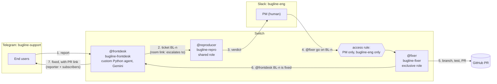

# Bugline

[](https://github.com/Ishaan2053/bugline/actions/workflows/ci.yml)

Users report bugs in the chat they already use; the team fixes them in the chat they already use;
Switch carries the work across, keeps a human in charge, and closes the loop back to the reporter.
A user writes `@frontdesk` in a Telegram group. A complete bug report crosses into a Slack channel
as ticket `BL-n`. A coding agent reproduces it. Only the PM can tell a second coding agent to fix
it. The fixer opens a pull request, and the front desk tells everyone who reported the bug, back
in Telegram, with the link.

<!-- author: add the demo GIF here (Telegram and Slack side by side, one full loop) -->

Built for the Flip the Switch Hackathon (WeMakeDevs x DevTools Academy x Switch), Track 01 "Best
Business Workflow".

<!-- author: add the video link here -->

## Why this stops working without Switch

Take Switch away and the two chats have no way to reach each other, and nothing stands between a
stranger and the agent that pushes code. Each piece below is a Switch primitive, and each one
carries part of the loop:

| Switch primitive | What Bugline uses it for | Without it |
| --- | --- | --- |
| Rooms on two chat apps | `bugline-support` is a Telegram group, `bugline-eng` is a Slack channel. Both are Switch rooms with the same agents in them. | You write and host a Telegram bot, a Slack bot and a bridge between them, and map users across both. |
| Room links | `bugline-support` → `bugline-eng` "escalates to"; `bugline-eng` → `bugline-support` "supports". Agents see that the other room exists and what it is for. A link grants no access. | Agents in `bugline-eng` have no idea the tickets come from users in a Telegram group, or where the answer goes back to. |
| Shared role `reproducer` | The front desk's ticket ends with `@reproducer`. Whoever holds the role gets it. | Tickets go to a hard-coded agent name. |
| Exclusive role `fixer` + custom access rule | One agent at a time holds `fixer`. A custom rule on `bugline-fixer` admits only the PM's user, only in `bugline-eng`. Anyone else who writes `@fixer` is refused by Switch, in the fixer's name, before the agent sees the message. This is the approval gate. | The gate is an `if` statement inside the agent, and a prompt can talk its way past it. |
| Targeted messages between agents | The front desk hands a ticket to the reproducer with `send_targeted_message`, which also says whether the target is reachable. The fixer hands the PR back with `@frontdesk BL-n`. | Agents poll a shared database or a queue you build. |
| Aliases | `bugline-frontdesk` is `@frontdesk` in both rooms. An agent holds one role across all rooms, so a per-room alias is how one agent works two rooms. | Users type internal agent names. |
| Room instructions, documents and the repo reference | Each room has its rules. `intake-rules.md`, `repro-checklist.md` and `fix-policy.md` go in the `bugline-kit` package with the `bugline-repo` GitHub reference. | Every agent's prompt carries its own copy of the rules, and the copies drift. |
| Console-managed coding agents and the room template | `switch/bugline.template.yaml` creates the Slack room, both coding agents, their roles, the reference and a kickoff message in one step. | You run and supervise two coding agents yourself. |

## Architecture

Two rooms on two chat apps, linked in Switch; three agents; one human gate; the answer goes back
to the person who asked.



The front desk is a member of both rooms and holds one WebSocket connection per room. The
reproducer and the fixer are coding agents (Claude Code or OpenCode) that Switch Console runs on the
author's machine, each in its own working directory. Questions, requests, off-topic messages,
incomplete reports and duplicates stay in `bugline-support`; only complete, new bugs cross the
link. The full rules are in [CLAUDE.md section 2](CLAUDE.md#2-architecture).

## Reproduce it in 15 minutes

Part A runs from a fresh clone with Docker and Python, and every command in it was run that way
before it was written here. Part B needs a Switch server, a Telegram bot and a Slack app of your
own, so it is summarised here and walked through in [docs/switch-setup.md](docs/switch-setup.md).

### Prerequisites

- Git and Docker with Compose v2
- Python 3.14
- For part B: Switch Console with a local server, Claude Code or OpenCode signed in, a Telegram
  bot, a Slack workspace you own, the GitHub CLI (`gh`), and a Google AI Studio key

### Part A: the demo app and the tests

Clone the repo and start the demo app, an expense splitter with seeded faults
([table in CLAUDE.md](CLAUDE.md#demo-app-expense-splitter-demo-app)).

PowerShell:

```powershell
git clone https://github.com/Ishaan2053/bugline.git
cd bugline
docker compose up --build -d
curl.exe -s http://localhost:8000/health
curl.exe -s http://localhost:8000/groups/1/balances
curl.exe -s http://localhost:8000/groups/1/settle
curl.exe -s -i http://localhost:8000/share/goa-trip-share
```

Bash:

```bash
git clone https://github.com/Ishaan2053/bugline.git
cd bugline
docker compose up --build -d
curl -s http://localhost:8000/health
curl -s http://localhost:8000/groups/1/balances
curl -s http://localhost:8000/groups/1/settle
curl -s -i http://localhost:8000/share/goa-trip-share
```

What you should see:

```text
{"status":"ok"}
{"group_id":1,"total_spent":9100.0,"members":[{"member_id":1,"name":"Asha","paid":5500.0,"owes":2933.33,"net":2566.67},{"member_id":2,"name":"Ravi","paid":3600.0,"owes":2933.33,"net":666.67},{"member_id":3,"name":"Meera","paid":0.0,"owes":3233.33,"net":-3233.33}]}
{"group_id":1,"transfers":[{"from":"Meera","to":"Asha","amount":2566.67},{"from":"Meera","to":"Ravi","amount":666.66}]}
HTTP/1.1 500 Internal Server Error
```

The 500 on the share link is fault 1, planted on purpose (`ZeroDivisionError` in
`docker compose logs demo-app`). The `owes` values add up to 9099.99 of 9100.00 spent: that is
fault 2. Stop the app with `docker compose down`.

Run the tests for the demo app and the front desk. PowerShell, from the repo root:

```powershell
cd demo-app
py -3.14 -m venv .venv
.\.venv\Scripts\Activate.ps1
pip install -r requirements-dev.txt
pytest -q
deactivate
cd ..\agents\frontdesk
py -3.14 -m venv .venv
.\.venv\Scripts\Activate.ps1
pip install -r requirements-dev.txt
pytest -q
python agent.py --help
```

Bash:

```bash
cd demo-app
python3.14 -m venv .venv
source .venv/bin/activate
pip install -r requirements-dev.txt
pytest -q
deactivate
cd ../agents/frontdesk
python3.14 -m venv .venv
source .venv/bin/activate
pip install -r requirements-dev.txt
pytest -q
python agent.py --help
```

Expect `8 passed` for the demo app and `43 passed, 1 skipped` for the front desk (the skipped test
calls Gemini and runs only with `BUGLINE_LIVE=1`). `agent.py --help` lists `--register` and
`--list-rooms`.

### Part B: the Switch setup (needs your own Switch server)

These steps need a live Switch server, Telegram and Slack, so they could not be run from a clean
clone. Follow [docs/switch-setup.md](docs/switch-setup.md) in order; in short:

1. Connect a Telegram bot and add it to a group: that group becomes `bugline-support`. Connect a
   Slack app. Link your own Telegram and Slack accounts.
2. Register the front desk once with `python agent.py --register`, using a registration key from
   the Gateway. Set **Who can talk to your agent → Anyone** for it in Switch Console, and invite
   it to the Telegram group with `!invite-agent @bugline-frontdesk`.
3. Import `switch/bugline.template.yaml` in Switch Console → **Templates** and run it on the Slack
   connection. It makes `bugline-eng`, `bugline-repro`, `bugline-fixer` and both roles.
4. Paste the briefs into each coding agent's instructions and give `bugline-fixer` the custom
   access rule: your user, room `bugline-eng`, no agents.
5. Run `scripts/setup_rooms.py` (try `--dry-run` first) for the room links, room instructions and
   aliases. Add the documents and the `bugline-kit` package in the Gateway.
6. Fill in `agents/frontdesk/.env` (see [.env.example](agents/frontdesk/.env.example)), start the
   front desk with `python agent.py`, and type `!follow-ups off` in both rooms.
7. Run the six seeded paths in [docs/switch-setup.md step 15](docs/switch-setup.md#15-smoke-run-the-six-seeded-paths).

## The workflow, step by step

One bug, fault 1 (the share link error), from report to fix, across both apps.

1. **Report.** A user in `bugline-support` writes
   `@frontdesk I opened the share link /share/goa-trip-share for group 1 and got "Internal Server Error"`.
   If a field is missing (steps, expected, actual, group), the front desk asks once for exactly
   that.
   <!-- author: add screenshot of the report and the front desk's reply in Telegram -->
2. **Handoff.** The front desk checks open tickets for a duplicate, opens `BL-1`, and posts it in
   `bugline-eng` in the shape in [intake-rules.md](switch/docs/intake-rules.md#handing-a-bug-to-bugline-eng),
   ending with `@reproducer`. The user is told the ticket id.
   <!-- author: add screenshot of BL-1 arriving in Slack -->
3. **Reproduce.** The reproducer runs a scratch script on a fresh seeded database and replies in
   the thread with the output, `Verdict: reproduced`, and the likely cause
   ([repro-checklist.md](switch/docs/repro-checklist.md)).
   <!-- author: add screenshot of the reproducer's verdict -->
4. **Refusal.** Someone who is not the PM writes `@fixer fix BL-1 now`. Switch refuses in the
   fixer's name. The fixer never sees it as an instruction.
   <!-- author: add screenshot of the refusal -->
5. **Approve and fix.** The PM replies in the thread:
   `@fixer go on BL-1, keep it to the share handler, add a regression test`. The fixer branches,
   writes the failing test, fixes one handler, runs `pytest -q` and ruff, and opens a PR titled
   `BL-1: ...` ([fix-policy.md](switch/docs/fix-policy.md)). It posts
   `@frontdesk BL-1 is fixed: <PR link>`.
   <!-- author: add screenshot of the fixer's PR message and the PR -->
6. **Close the loop.** The front desk closes `BL-1` and posts in `bugline-support` that it is fixed,
   with the link, to the reporter and to every user whose duplicate report was matched to `BL-1`.
   <!-- author: add screenshot of the "BL-1 is fixed" message in Telegram -->

The quiet paths (a question answered from the user guide, a vague report, a duplicate, an
off-topic message) are rows 3 to 6 of the
[seeded-faults table](CLAUDE.md#demo-app-expense-splitter-demo-app). The exact messages for each,
and the "not reproduced" check, are in
[switch-setup.md step 15](docs/switch-setup.md#15-smoke-run-the-six-seeded-paths).

## The agents

Three agents, one job each. Switch, not the agents, decides who may instruct each one.

| Agent | Addressed as | Runtime | Switch role | Who may instruct it | Brief |
| --- | --- | --- | --- | --- | --- |
| `bugline-frontdesk` | `@frontdesk` (alias in both rooms) | Custom Python agent over the Switch agent protocol; Gemini through `google-genai` | none (an alias, since an agent holds one role across all rooms) | Anyone | [frontdesk.md](switch/agent-briefs/frontdesk.md) |
| `bugline-repro` | `@reproducer`, `@bugline-repro` | Coding agent run by Switch Console (Claude Code or OpenCode) | `reproducer`, shared | The PM and the front desk ("Me and my agents") | [reproducer.md](switch/agent-briefs/reproducer.md) |
| `bugline-fixer` | `@fixer`, `@bugline-fixer` | Coding agent run by Switch Console (Claude Code or OpenCode) | `fixer`, exclusive | The PM only, in `bugline-eng` only (custom access rule) | [fixer.md](switch/agent-briefs/fixer.md) |

The front desk's code and its settings are described in
[agents/frontdesk/README.md](agents/frontdesk/README.md).

## The problem this solves for a real team

A small product team gets bug reports where its users are, not where its engineers are: a support
WhatsApp or Telegram group, while engineering works in Slack. Today someone copies each report
across by hand, asks the user for the missing details, and forgets to tell them when it is fixed.
Bugline moves only complete, new bugs across, gives each one a ticket id and a reproduction before
a person looks at it, keeps the decision to change code with one named person, and tells every
reporter when the fix is up. The demo app is an expense splitter, but nothing in the rooms, briefs
or front desk depends on it beyond the user guide and the repo reference.

<!-- author: add model-call count per full loop and wall time from a live run (calls.log) -->

## What the agents got wrong and how the briefs fixed it

No live agent run has happened yet. These are the things the build got wrong before then, and
where the fix lives:

- **The plan assumed one WebSocket could cover both rooms.** The Switch docs and server source say
  one connection covers one room. The front desk holds two connections, and each operation call
  carries the connection id of the room it acts in
  ([CLAUDE.md section 5](CLAUDE.md#5-switch-protocol-facts-for-the-custom-frontdesk)).
- **The plan assumed `post_message` takes mentions.** It does not, and events carry no mentions
  list. Handoffs use `send_targeted_message`, and the front desk reads `BL-n` and the PR link
  from the message body, which is why [fix-policy.md](switch/docs/fix-policy.md) fixes the exact
  shape of the fixer's done message.
- **The plan had the front desk open itself to "anyone".** The server refuses that with 403. The
  owner sets it in Switch Console ([switch-setup.md step 6](docs/switch-setup.md#6-let-anyone-talk-to-the-front-desk)).
- **The plan put the PM-only rule in the template.** Templates offer only three presets. The
  fixer's rule is a custom access rule set in Console, and
  [fixer.md](switch/agent-briefs/fixer.md) says that rule, not the agent's own checks, is the gate.
- **The plan made `@frontdesk` a role.** An agent holds one role across all rooms, so it became a
  per-room alias.
- **`gemini-2.5-flash-lite` returned 404**, "no longer available to new users". The lite model is
  now `gemini-3.5-flash-lite`, named once in `agents/frontdesk/config.py`.

The day-by-day record is in [docs/build-journal.md](docs/build-journal.md).

<!-- author: add what the reproducer and fixer got wrong in live runs, and the brief change that fixed each -->

## Built with Wispr Flow

<!-- author: one or two sentences on what you dictated with Wispr Flow (prompts, journal,
reviews) and what the Insights numbers show -->

<!-- author: add the Wispr Insights scorecard image (docs/wispr-scorecard.png) -->

## Repo layout

```text
demo-app/            FastAPI + SQLite expense splitter with seeded faults, tests, Dockerfile
agents/frontdesk/    the custom Switch agent: protocol client, handlers, Gemini calls, SQLite store
switch/              room template, room instructions, docs/ (shared documents), agent-briefs/
scripts/             setup_rooms.py: room links, instructions and aliases through the Switch ops API
docs/                switch-setup.md (full Switch walkthrough), build-journal.md
docker-compose.yml   demo app; front desk under the `agents` profile
CLAUDE.md            project context for coding agents, including the seeded-faults table
```

## Tests and CI

[`.github/workflows/ci.yml`](.github/workflows/ci.yml) runs `ruff format --check`, `ruff check`
and `pytest -q` for `demo-app/` and `agents/frontdesk/` on Python 3.14.7, on every pull request
and on `main`. The tests that would catch faults 1 and 2 are left out on purpose; the fixer adds
them during the demo.

## Limits and next steps

- Part B has not been run end to end against a live Switch server yet. Steps the docs do not
  cover are marked **(unverified)** in [docs/switch-setup.md](docs/switch-setup.md).
- A role mention reaches an agent only while its session holds the role. If `@reproducer` or
  `@fixer` gets no answer, address the agent by name
  ([switch-setup.md step 14](docs/switch-setup.md#14-when-a-role-mention-reaches-nobody)).
- The template cannot make the Telegram room or link to it, register the front desk, set custom
  access rules or attach packages. The setup script and guide cover these by hand.
- Feature requests are logged by the front desk, not handed over. Next step: show them to the PM.
- The front desk runs on the Gemini free tier. It backs off on HTTP 429 and, if that fails, tells
  the user it is rate-limited rather than going quiet.

## Licence and credits

MIT, see [LICENSE](LICENSE).

Built on [Switch](https://github.com/sandbox-quantum/switch), for the
[Flip the Switch Hackathon](https://www.wemakedevs.org/hackathons/switch) run by WeMakeDevs. The
front desk uses Google [Gemini](https://ai.google.dev/) through `google-genai`. The demo app uses
[FastAPI](https://fastapi.tiangolo.com/). The room template follows the shape of the official
two-agent example template in the Switch repo.
